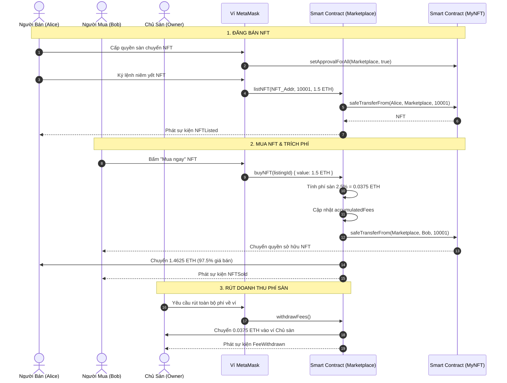

# BÁO CÁO DỰ ÁN

## XÂY DỰNG SÀN GIAO DỊCH NFT TRÊN BLOCKCHAIN CỤC BỘ

---

## THÔNG TIN TỔNG QUAN ĐỀ TÀI

- **Tên đề tài:** Xây dựng sàn giao dịch NFT đơn giản (NFT Marketplace).
- **Yêu cầu cốt lõi:** Cho phép đăng bán, mua, hủy niêm yết NFT; trích phí giao dịch tự động cho chủ sàn; chủ sàn có quyền xem, chỉnh và rút phí; cung cấp sẵn tài khoản và kho 10,000 NFT giả lập để giao dịch trực tiếp qua ví MetaMask.
- **Công nghệ chính:** Solidity (^0.8.24), OpenZeppelin Contracts v5, Hardhat 3, Web3.js v4, Ethers.js v6, React 19, TypeScript, Tailwind CSS.
- **Môi trường triển khai:** Blockchain cục bộ Hardhat Localnet (Chain ID `31337`).
- **Sinh viên thực hiện:** [Họ và tên] — **MSSV:** [Mã số sinh viên]
- **Lớp/Học phần:** [Lớp] / [Tên học phần]
- **Giảng viên hướng dẫn:** [Họ tên giảng viên]
- **Trường/Khoa:** [Tên trường] / [Tên khoa]

> Khi đưa vào Word, dùng khổ A4, Times New Roman cỡ 13, giãn dòng 1,5; căn đều nội dung; đặt Heading 1 cho chương, Heading 2 cho mục; ngắt trang sau trang bìa và trước mỗi chương. Thay các trường trong ngoặc vuông bằng thông tin thật và cập nhật mục lục tự động sau khi định dạng.

## LỜI CAM ĐOAN

Em cam đoan nội dung báo cáo phản ánh quá trình tìm hiểu và xây dựng dự án NFT Marketplace trong phạm vi học phần. Các mô tả kỹ thuật được đối chiếu với mã nguồn dự án; kết quả kiểm thử và build chỉ được trình bày trong phạm vi đã thực hiện. Dự án chạy trên Hardhat Localnet với tài khoản và tài sản giả lập, không phải hệ thống giao dịch trên mạng chính.

**Sinh viên thực hiện:** [Họ và tên]  
**Ngày:** [Ngày/tháng/năm]

## LỜI CẢM ƠN

Em xin cảm ơn [tên giảng viên] đã hướng dẫn và cung cấp kiến thức nền tảng trong học phần [tên học phần]. Em cũng xin cảm ơn cộng đồng phát triển Solidity, Hardhat, OpenZeppelin, ethers.js, React và các công cụ mã nguồn mở đã cung cấp tài liệu hỗ trợ quá trình thực hiện đề tài. Em mong nhận được góp ý để tiếp tục hoàn thiện sản phẩm và báo cáo.

## TÓM TẮT

Đề tài xây dựng một ứng dụng sàn giao dịch NFT nhằm minh họa quy trình tạo listing, mua, hủy listing và quản trị phí trên một blockchain tương thích EVM. Hệ thống gồm hai hợp đồng Solidity: `MyNFT` mô phỏng bộ sưu tập ERC-721 và `NFTMarketplace` quản lý listing, chuyển NFT, thanh toán ETH và thu phí. Người dùng thao tác trên giao diện React, kết nối MetaMask để xem trạng thái ví và ký giao dịch. Backend Express cung cấp các API chỉ đọc dữ liệu từ blockchain; nó không giữ khóa riêng tư và không ký thay người dùng.

Ứng dụng chạy trên Hardhat Localnet với Chain ID 31337, vì vậy ETH và NFT trong demo là dữ liệu giả lập, không có giá trị trên mạng công khai. Hợp đồng marketplace áp dụng mức phí mặc định 250 BPS (2,5%); chủ sở hữu có thể điều chỉnh mức phí không vượt quá 1.000 BPS (10%). Hợp đồng NFT cung cấp ba dải Token ID mẫu, mỗi tài khoản có số dư khởi tạo 10.000 NFT theo cơ chế mô phỏng quyền sở hữu.

Tại thời điểm lập báo cáo, bộ kiểm thử Hardhat có 10 trường hợp và cả 10 đều chạy thành công. Frontend cũng build thành công; công cụ build có đưa ra cảnh báo kích thước một chunk JavaScript lớn hơn 500 kB. Kết quả này xác nhận các ca kiểm thử đã viết hoạt động, nhưng không đồng nghĩa với độ bao phủ mã nguồn 100% hay bảo đảm an toàn production.

**Từ khóa:** Blockchain, NFT, ERC-721, Solidity, Hardhat, MetaMask, Smart Contract, Marketplace.

---

## MỤC LỤC BÁO CÁO

- [LỜI CAM ĐOAN](#lời-cam-đoan)
- [LỜI CẢM ƠN](#lời-cảm-ơn)
- [TÓM TẮT](#tóm-tắt)
- [DANH MỤC TỪ VIẾT TẮT](#danh-mục-từ-viết-tắt)
- [DANH MỤC HÌNH VÀ BẢNG](#danh-mục-hình-và-bảng)
- [CHƯƠNG 1: TỔNG QUAN VÀ CÔNG NGHỆ](#chương-1-tổng-quan-và-công-nghệ)
  - 1.1. Bối cảnh công nghệ Blockchain & Web3
  - 1.2. Khái niệm và tiềm năng của NFT (Non-Fungible Token)
  - 1.3. Lý do lựa chọn đề tài, mục tiêu và phạm vi
  - 1.4. Đối tượng thụ hưởng hệ thống
  - 1.5. Cơ sở lý thuyết nền tảng (ERC-721, ký quỹ NFT, kiểm soát quyền và reentrancy)
  - 1.6. Danh mục công cụ và công nghệ áp dụng
  - 1.7. Yêu cầu chức năng và phi chức năng
  - 1.8. Phương pháp thực hiện
- [CHƯƠNG 2: XÂY DỰNG VÀ THIẾT KẾ HỆ THỐNG](#chương-2-xây-dựng-và-thiết-kế-hệ-thống)
  - 2.1. Kiến trúc tổng thể 3 tầng (3-Tier dApp Architecture)
  - 2.2. Sơ đồ tương tác luồng dữ liệu (Sequence Diagram)
  - 2.3. Thiết kế Smart Contract chi tiết (`NFTMarketplace.sol` & `MyNFT.sol`)
  - 2.4. Mô tả chi tiết nhóm chức năng dành cho Chủ Sàn (Marketplace Owner)
  - 2.5. Mô tả chi tiết nhóm chức năng dành cho Người Dùng (Trader / Collector)
  - 2.6. Thách thức kỹ thuật và cách xử lý (mô phỏng NFT, nonce, đồng bộ địa chỉ)
  - 2.7. Thiết kế API và trách nhiệm từng thành phần
  - 2.8. Cấu trúc mã nguồn và tổ chức triển khai
- [CHƯƠNG 3: DEMO HỆ THỐNG](#chương-3-demo-hệ-thống)
  - 3.1. Thiết lập môi trường chạy thử & 3 tài khoản giả lập mặc định
  - 3.2. Demo Kịch bản 1: Người dùng 1 (Alice) đăng bán NFT qua MetaMask
  - 3.3. Demo Kịch bản 2: Người dùng 2 (Bob) mua NFT & cơ chế trích phí sàn tự động
  - 3.4. Demo Kịch bản 3: Chủ sàn xem doanh thu phí, đổi tỷ lệ % phí và rút phí về ví
  - 3.5. Demo Kịch bản 4: Người bán hủy tin niêm yết NFT
  - 3.6. Demo tương tác dòng lệnh với thư viện Web3.js
  - 3.7. Kết quả kiểm thử tự động
  - 3.8. Đánh giá kết quả và giới hạn
  - 3.9. Kết luận và hướng phát triển
- [TÀI LIỆU THAM KHẢO](#tài-liệu-tham-khảo)

## DANH MỤC TỪ VIẾT TẮT

| Từ viết tắt | Ý nghĩa |
|---|---|
| ABI | Application Binary Interface – mô tả giao diện gọi hàm/sự kiện hợp đồng |
| API | Application Programming Interface – giao diện lập trình ứng dụng |
| BPS | Basis Point – điểm cơ bản; 100 BPS tương đương 1% |
| dApp | Decentralized Application – ứng dụng phi tập trung |
| EIP-1193 | Chuẩn giao tiếp provider Ethereum cho ứng dụng web |
| EVM | Ethereum Virtual Machine |
| NFT | Non-Fungible Token – token không thể thay thế |
| RPC | Remote Procedure Call – giao thức gọi thủ tục từ xa |
| UI | User Interface – giao diện người dùng |

## DANH MỤC HÌNH VÀ BẢNG

| Số hiệu | Tên |
|---|---|
| Hình 2.1 | Kiến trúc tổng thể hệ thống |
| Hình 2.2 | Luồng tương tác đăng bán, mua và rút phí |
| Hình 3.1–3.10 | Ảnh minh chứng chạy demo cần bổ sung |
| Bảng 1.1 | Yêu cầu chức năng hệ thống |
| Bảng 1.2 | Yêu cầu phi chức năng |
| Bảng 2.1 | Các API backend |
| Bảng 3.1 | Các tài khoản mẫu trên Hardhat Localnet |
| Bảng 3.2 | Ma trận kiểm thử hợp đồng |

---

## CHƯƠNG 1: TỔNG QUAN VÀ CÔNG NGHỆ

### 1.1. Bối cảnh công nghệ Blockchain & Web3
Blockchain là một dạng sổ cái phân tán, trong đó các nút mạng cùng kiểm tra và lưu trạng thái theo quy tắc đồng thuận của mạng. Smart contract cho phép thực thi logic trên EVM khi nhận giao dịch hợp lệ. Tính minh bạch của dữ liệu on-chain giúp các bên có thể kiểm tra giao dịch, nhưng không đồng nghĩa mọi dữ liệu ngoài chuỗi đều đúng hoặc mọi giao dịch đều không thể đảo ngược trong mọi hoàn cảnh.

### 1.2. Khái niệm và tiềm năng của NFT (Non-Fungible Token)
- **NFT (Non-Fungible Token - Token không thể thay thế)** là token có định danh riêng trên blockchain; ERC-721 là một tiêu chuẩn phổ biến cho nhóm tài sản này.
- Khác với token có thể thay thế, mỗi NFT có một `tokenId` riêng. Blockchain có thể ghi nhận địa chỉ đang sở hữu token, nhưng việc sở hữu NFT không tự động đồng nghĩa với quyền tác giả, bản quyền hoặc quyền sở hữu pháp lý đối với tài sản ngoài đời thực.

### 1.3. Lý do lựa chọn đề tài, mục tiêu và phạm vi
1. **Lý do chọn đề tài:** 
   - Sự bùng nổ của các sàn giao dịch tài sản số hàng đầu thế giới (như OpenSea, Rarible, Blur) cho thấy vai trò trung tâm của sàn thương mại điện tử phi tập trung trong nền kinh tế số.
   - Thử nghiệm trên mạng công khai có thể phát sinh phí giao dịch và phụ thuộc vào cấu hình mạng. Vì vậy, đề tài xây dựng một sàn giao dịch NFT mô phỏng trên Hardhat Localnet, dùng ETH giả lập và tài khoản thử nghiệm để người học thực hành mà không sử dụng tiền thật.
2. **Mục tiêu của dự án:**
   - Xây dựng hợp đồng NFT tương thích ERC-721 và mô phỏng số dư ban đầu 10,000 NFT cho mỗi tài khoản mẫu.
   - Xây dựng Smart Contract Marketplace quản lý niêm yết, mua bán, hủy bán và trích phí sàn tự động.
   - Phát triển giao diện Web dApp tương tác trực tiếp với ví điện tử MetaMask theo chuẩn Web3.
   - Viết các unit test cho những quy tắc nghiệp vụ chính của hợp đồng; kết quả chạy hiện có là 10 ca kiểm thử đạt. Chưa thực hiện đo độ bao phủ mã nguồn.
3. **Phạm vi nghiên cứu:**
   - Môi trường blockchain cục bộ: Hardhat Localnet (RPC: `http://127.0.0.1:8545`, Chain ID: `31337`).
   - Đơn vị thanh toán: ETH giả lập trên localnet; không phải ETH testnet hoặc ETH có giá trị thật.
   - Đề tài chưa triển khai lên mạng công khai, chưa tích hợp IPFS cho metadata và chưa được kiểm toán bảo mật độc lập.

### 1.4. Đối tượng thụ hưởng hệ thống
- **Chủ sàn (Marketplace Owner):** Nắm quyền quản trị, xem mức phí và phí tích lũy, cập nhật tỷ lệ phí hoặc rút phí theo quyền của hợp đồng.
- **Người bán (Seller):** Quản lý kho NFT, chọn tài sản và mức giá để tạo listing; có thể hủy listing đang hoạt động của mình.
- **Người mua (Buyer):** Xem, tìm kiếm listing theo Token ID/người bán hoặc mã listing; mua NFT thông qua giao dịch được ký bằng MetaMask.

### 1.5. Cơ sở lý thuyết nền tảng
- **Chuẩn ERC-721:** Định nghĩa các phương thức chuẩn mực: `ownerOf(tokenId)`, `balanceOf(owner)`, `setApprovalForAll(operator, approved)`, `transferFrom(from, to, tokenId)`.
- **Ký quỹ NFT trong hợp đồng (escrow):** Người bán cấp quyền cho marketplace qua `setApprovalForAll`. Khi đăng bán, hợp đồng gọi `safeTransferFrom` để chuyển NFT từ ví người bán vào địa chỉ marketplace. Khi mua, marketplace chuyển NFT cho người mua và gửi phần ETH còn lại cho người bán trong cùng một giao dịch nguyên tử. Do NFT được lưu tại hợp đồng trong thời gian listing hoạt động, đây là mô hình ký quỹ có lưu giữ NFT, không phải mô hình phi lưu ký.
- **Kiểm soát quyền:** `Ownable` giới hạn việc đổi phí và rút phí vào owner của hợp đồng. Các điều kiện sở hữu NFT, trạng thái listing và số tiền thanh toán được kiểm tra trong hợp đồng.
- **Giảm thiểu reentrancy:** `ReentrancyGuard` được dùng trên các hàm có tương tác chuyển NFT/ETH phù hợp trong mã nguồn. Đây là một lớp giảm thiểu rủi ro, không thay thế kiểm thử, review hoặc kiểm toán bảo mật.

### 1.6. Danh mục công cụ và công nghệ áp dụng

| Lớp Công nghệ | Công cụ / Thư viện | Phiên bản | Vai trò trong hệ thống |
| :--- | :--- | :--- | :--- |
| **Smart Contract** | Solidity | Pragma `^0.8.24`; compiler Hardhat `0.8.34` | Viết mã nguồn hợp đồng thông minh; Solidity 0.8 có kiểm tra tràn số học |
| **Bảo mật Web3** | OpenZeppelin Contracts | `^5.6.1` theo package.json | Thư viện chuẩn cho ERC-721, Ownable và ReentrancyGuard |
| **Blockchain Node** | Hardhat | `^3.21.2` theo package.json | Biên dịch, kiểm thử và chạy blockchain cục bộ |
| **Kiểm thử tự động** | Mocha & Chai | `^12.0.3 / ^6.3.0` | Viết và chạy unit test hợp đồng |
| **Giao tiếp Web3** | Web3.js & ethers.js | `^4.16.0 / ^6.17.0` | Đọc RPC, mã hóa ABI, gọi hợp đồng và gửi giao dịch |
| **Ví tiền mã hóa** | MetaMask Extension | Mới nhất | Xác thực tài khoản người dùng, ký duyệt giao dịch an toàn |
| **Backend API** | Express + TypeScript | Express `^5.3.0` | Cung cấp REST API đọc dữ liệu blockchain |
| **Frontend Client** | React & Tailwind CSS | React `^19.3.1`, Tailwind `^4.3.5` | Giao diện dApp; Vite phục vụ phát triển/build, Lucide cung cấp icon |

Các phiên bản có ký hiệu `^` là khoảng phiên bản khai báo trong manifest, không phải cam kết rằng mọi máy chạy cùng chính xác một bản cài đặt. Với báo cáo nộp chính thức, nên ghi phiên bản lấy từ lockfile/môi trường thực tế.

### 1.7. Yêu cầu chức năng và phi chức năng

#### Yêu cầu chức năng

**Bảng 1.1. Yêu cầu chức năng hệ thống**

| Mã | Yêu cầu | Tác nhân chính | Kết quả mong đợi |
|---|---|---|---|
| FR-01 | Kết nối MetaMask và kiểm tra Chain ID | Người dùng | Giao diện nhận tài khoản và yêu cầu chuyển sang Chain ID 31337 khi cần |
| FR-02 | Xem, tìm kiếm và sắp xếp listing | Khách truy cập | Hiển thị listing active theo Token ID, seller, listing ID hoặc giá |
| FR-03 | Xem kho NFT theo trang | Người dùng | Hiển thị NFT và tổng số dư của tài khoản hiện hành |
| FR-04 | Đăng bán NFT | Người bán | Approve nếu cần, sau đó tạo listing và đưa NFT vào escrow của Marketplace |
| FR-05 | Mua NFT | Người mua | Chỉ mua listing active của người khác, gửi đúng giá và nhận NFT khi giao dịch thành công |
| FR-06 | Hủy listing | Người bán | Chỉ seller của listing active được hủy và nhận lại NFT |
| FR-07 | Cập nhật tỷ lệ phí | Chủ sàn | Owner cập nhật mức phí không vượt quá 1.000 BPS |
| FR-08 | Rút phí tích lũy | Chủ sàn | Owner rút phí khi số dư tích lũy lớn hơn 0 |
| FR-09 | Đọc lịch sử sự kiện | Người dùng | Xem các sự kiện listing, mua và hủy hiện được frontend hỗ trợ |

#### Yêu cầu phi chức năng

**Bảng 1.2. Yêu cầu phi chức năng**

| Nhóm | Mô tả |
|---|---|
| Tính đúng đắn | Hợp đồng kiểm tra quyền sở hữu, trạng thái listing, giá thanh toán và quyền owner |
| An toàn giao dịch | Giao dịch được người dùng ký trong MetaMask; giao diện chờ receipt và kiểm tra trạng thái |
| Minh bạch | Trạng thái cốt lõi và các event nghiệp vụ được ghi trên blockchain |
| Khả dụng cho học tập | Chạy local không cần ETH thật; có tài khoản mẫu và script triển khai |
| Khả năng sử dụng | Giao diện hiển thị loading, kết quả và lỗi giao dịch ở mức cơ bản |
| Giới hạn môi trường | Hardhat Localnet là node phát triển; dữ liệu có thể mất khi dừng hoặc reset node |

### 1.8. Phương pháp thực hiện

Đề tài được thực hiện theo các bước:

1. **Khảo sát và xác định phạm vi:** đọc yêu cầu bài toán, xác định vai trò chủ sàn/người bán/người mua và giới hạn demo trên Hardhat Localnet.
2. **Thiết kế:** xác định cấu trúc hợp đồng, trạng thái listing, quy tắc thanh toán/phí, API đọc dữ liệu và luồng giao dịch qua MetaMask.
3. **Hiện thực:** viết hợp đồng Solidity, unit test, backend Express, giao diện React và script deploy/demo.
4. **Kiểm thử và đánh giá:** chạy `npm test`, build frontend, sau đó đối chiếu các luồng thao tác với trạng thái hợp đồng và ghi nhận các giới hạn.

Phương pháp đánh giá dựa trên kết quả của các test đã viết và khả năng chạy các kịch bản demo. Báo cáo không đưa ra kết luận về độ bao phủ toàn bộ mã nguồn, hiệu năng trên mạng công khai hay mức độ an toàn sau kiểm toán.

---

## CHƯƠNG 2: XÂY DỰNG VÀ THIẾT KẾ HỆ THỐNG

### 2.1. Kiến trúc tổng thể 3 tầng (3-Tier dApp Architecture)

**Hình 2.1. Kiến trúc tổng thể hệ thống**

```
+---------------------------------------------------------------+
|                    TẦNG TRÌNH DIỄN (CLIENT)                   |
|   - Giao diện Web dApp (React 19 + TypeScript + Tailwind CSS)  |
|   - Tiện ích ví Web3 MetaMask (EIP-1193 Provider)             |
+-------------------------------+-------------------------------+
                                | (JSON-RPC / window.ethereum)
                                v
+---------------------------------------------------------------+
|               TẦNG DỊCH VỤ TRUNG GIAN & BLOCKCHAIN            |
|   - Node Blockchain Hardhat Localnet (http://127.0.0.1:8545)   |
|   - Máy chủ Backend REST API (Node.js Express / Port 3000)    |
|   - Cầu nối Ethers.js v6 & Web3.js v4                         |
+-------------------------------+-------------------------------+
                                | (EVM Bytecode Execution)
                                v
+---------------------------------------------------------------+
|                 TẦNG HỢP ĐỒNG THÔNG MINH (ON-CHAIN)           |
|   - MyNFT.sol: Kho 30,000 NFT (10,000 NFT/tài khoản)          |
|   - NFTMarketplace.sol: Niêm yết, Mua bán, Phí sàn            |
+---------------------------------------------------------------+
```

Luồng **đọc dữ liệu** có thể đi qua REST API: frontend gửi HTTP request đến backend, backend dùng ethers.js provider để truy vấn RPC và trả JSON. Một số dịch vụ frontend có fallback đọc trực tiếp blockchain nếu API không hoạt động. Luồng **ghi dữ liệu** không đi qua backend: frontend tạo contract call bằng signer từ MetaMask, ví yêu cầu người dùng xác nhận, sau đó gửi transaction đến Hardhat RPC. Khi nhận receipt thành công, frontend tải lại các dữ liệu liên quan.

---

### 2.2. Sơ đồ tương tác luồng dữ liệu (Sequence Diagram)

**Hình 2.2. Luồng tương tác đăng bán, mua và rút phí**



---

### 2.3. Thiết kế Smart Contract chi tiết

#### 1. Hợp đồng `NFTMarketplace.sol`
- **Kế thừa và vai trò:** `ERC721Holder` cho phép marketplace nhận NFT an toàn; `Ownable` xác định owner; `ReentrancyGuard` giảm thiểu gọi lồng lại trên các thao tác nhạy cảm.
- **Cấu trúc dữ liệu `Listing`:**
  ```solidity
  struct Listing {
      uint256 listingId;    // Mã định danh lệnh bán duy nhất
      address nftContract;  // Địa chỉ hợp đồng NFT được bán
      address seller;       // Địa chỉ ví người bán
      uint256 tokenId;      // Mã Token ID của NFT
      uint256 price;        // Đơn giá bán (đơn vị Wei)
      bool active;          // Trạng thái (true: đang bán, false: đã bán hoặc hủy)
  }
  ```
- **Các hàm cốt lõi:**
  - `listNFT(address nftContract, uint256 tokenId, uint256 price)`: kiểm tra địa chỉ NFT hợp lệ, giá lớn hơn 0 và người gọi sở hữu token. Sau đó tạo listing, chuyển NFT vào marketplace bằng `safeTransferFrom` và phát `NFTListed`. Quyền approve chưa đủ để hợp đồng chuyển tài sản nếu người bán chưa approve; nếu thiếu approve, giao dịch sẽ revert.
  - `buyNFT(uint256 listingId) payable nonReentrant`: yêu cầu listing đang hoạt động, người mua khác người bán và `msg.value` bằng chính xác giá. Hợp đồng xóa listing, tính phí, cập nhật phí tích lũy, chuyển NFT từ marketplace sang người mua và gửi tiền ròng cho người bán. Nếu một thao tác chuyển tài sản thất bại, toàn bộ giao dịch revert.
  - `cancelListing(uint256 listingId)`: chỉ người bán của listing đang hoạt động được gọi; listing được xóa và NFT được chuyển trả cho người bán.
  - `setFeePercent(uint256 newFee) external onlyOwner`: owner cập nhật phí theo BPS, giới hạn không quá 1.000 BPS (10%). Giá trị mặc định 250 BPS tương đương 2,5%.
  - `withdrawFees() external onlyOwner nonReentrant`: owner rút toàn bộ ETH phí đã tích lũy; nếu gửi ETH thất bại, giao dịch revert và số dư phí không bị mất.
  - `getAllActiveListings()`: hàm `view` duyệt các ID đã tạo để trả về những listing còn active. Cách duyệt phù hợp quy mô demo; nếu số listing tăng lớn, cần cân nhắc indexer hoặc thiết kế truy vấn hiệu quả hơn.

Phí được tính bằng phép chia số nguyên: `fee = price * feePercent / 10000`. Vì vậy phần dư nhỏ hơn một wei bị làm tròn xuống. Nếu giá trị giao dịch rất nhỏ, phí có thể bằng 0.

#### 2. Hợp đồng `MyNFT.sol`
- Chuẩn ERC-721, phân bổ sẵn 10,000 NFT cho mỗi tài khoản mặc định:
  - Chủ sàn: Token `#1` đến `#10,000`.
  - Alice (Người dùng 1): Token `#10,001` đến `#20,000`.
  - Bob (Người dùng 2): Token `#20,001` đến `#30,000`.
- Hỗ trợ hàm phân trang: `getTokensOfOwner(account, page, pageSize)` giúp dApp tải mượt mà danh mục NFT mà không gây tràn bộ nhớ trình duyệt.
- Hợp đồng khởi tạo số dư bằng `_increaseBalance` và override `_ownerOf` để xác định quyền sở hữu theo các khoảng Token ID. Cách làm này tránh gọi `_safeMint` 30.000 lần khi khởi tạo, nhưng các token ban đầu không được phát hành thành 30.000 giao dịch/event `Transfer` riêng. Đây là cơ chế mô phỏng phục vụ demo, không nên nhầm với quy trình phát hành NFT thông thường.
- Khi token được chuyển, trạng thái ERC-721 tường minh được ghi nhận và danh sách token nhận được cập nhật để hỗ trợ truy vấn. Hàm `mintNFT` tạo ID mới từ 30.001. Metadata hình ảnh chưa được lưu trên IPFS; giao diện hiện sinh artwork minh họa theo Token ID.

---

### 2.4. Mô tả chi tiết nhóm chức năng dành cho Chủ Sàn (Marketplace Owner)
1. **Xem thông tin tài chính sàn:** Xem tổng phí đang tích lũy trong hợp đồng và tỷ lệ hiện hành tại thời điểm dữ liệu được tải hoặc làm mới.
2. **Cập nhật tỷ lệ phí sàn (`setFeePercent`):** Hợp đồng cho phép owner đặt mức phí từ 0% đến 10% (0–1.000 BPS, ví dụ 2,5% là 250 BPS). Giao dịch yêu cầu xác nhận trên MetaMask của tài khoản Chủ sàn. Giao diện mô tả mức thấp nhất 0,1%, nhưng kiểm tra trong handler hiện cho phép nhập 0; đây là điểm cần thống nhất nếu tiếp tục hoàn thiện UX.
3. **Rút phí giao dịch về ví (`withdrawFees`):** Bấm nút "Rút toàn bộ phí về ví" trên tab Quản trị, toàn bộ số dư ETH phí sàn tích lũy sẽ được chuyển thẳng về địa chỉ ví MetaMask của Chủ sàn.

Các thao tác quản trị được kiểm tra thêm ở hợp đồng bằng `onlyOwner`; ẩn/hiện nút trên giao diện không phải là biện pháp phân quyền duy nhất. Chủ sàn mặc định là tài khoản triển khai hợp đồng. Tỷ lệ phí hiện hành được áp dụng tại thời điểm mua, không được đóng băng riêng theo listing.

---

### 2.5. Mô tả chi tiết nhóm chức năng dành cho Người Dùng (Trader / Collector)
1. **Kết nối & Chuyển mạng MetaMask:** Frontend yêu cầu kết nối ví, kiểm tra Chain ID và gửi yêu cầu chuyển hoặc thêm mạng **Hardhat Localnet (Chain ID 31337)** khi cần.
2. **Quản lý kho NFT cá nhân:** Hiển thị kho NFT theo tài khoản, artwork minh họa sinh màu theo Token ID và phân trang 12 NFT/trang.
3. **Đăng bán NFT:** Người dùng nhập Token ID và giá ETH mong muốn. Quy trình 2 bước qua MetaMask: Phê duyệt (`setApprovalForAll`) $\rightarrow$ Ký lệnh niêm yết (`listNFT`).
4. **Mua NFT:** Tại tab "Khám phá Sàn", người mua chọn listing đang hoạt động, bấm "Mua ngay" và xác nhận thanh toán ETH qua MetaMask; sau khi giao dịch thành công, NFT được chuyển về ví người mua.
5. **Hủy tin niêm yết:** Người bán có quyền hủy tin đăng bán bất cứ lúc nào khi chưa ai mua để thu hồi NFT về kho.
6. **Lịch sử giao dịch on-chain:** Giao diện đọc các sự kiện đăng bán, mua và hủy listing kèm dữ liệu listing và block. Hợp đồng có phát thêm `FeeWithdrawn` và `FeePercentUpdated`, nhưng backend/frontend hiện chưa đưa đầy đủ hai loại này vào danh sách lịch sử; không nên mô tả màn hình hiện tại là đã hiển thị toàn bộ sự kiện.

---

### 2.6. Thách thức kỹ thuật và cách xử lý

| Thách thức | Nguyên nhân | Cách xử lý và giới hạn |
|---|---|---|
| Mô phỏng 30.000 NFT | Gọi `_safeMint` riêng cho từng token khi triển khai sẽ cần nhiều thao tác trạng thái và phát sinh chi phí/gas lớn. | `MyNFT` tăng số dư khởi tạo và xác định chủ sở hữu theo dải Token ID thông qua `_ownerOf`. Đây là cơ chế mô phỏng; không có 30.000 sự kiện mint riêng và không được xem là phép đo hiệu năng 0,5 giây. |
| Nonce MetaMask lệch sau khi node khởi động lại | Hardhat Node local có thể khởi động với trạng thái giao dịch mới, trong khi MetaMask còn lưu hoạt động của mạng local trước đó. | Ứng dụng không tự ép nonce vào giao dịch; ethers.js gửi yêu cầu ký qua MetaMask và chờ receipt. Người dùng cần đảm bảo đúng Chain ID 31337; nếu MetaMask vẫn dùng nonce cũ, xóa dữ liệu hoạt động/nonce của mạng Hardhat Local rồi tải lại dApp. Sau khi node reset, cần kiểm tra hợp đồng đã được deploy lại. |
| Địa chỉ hợp đồng thay đổi khi deploy lại | Mạng local mới có thể tạo địa chỉ hợp đồng khác với cấu hình cũ. | `scripts/deploy.ts` ghi địa chỉ mới vào `.env` và `frontend/src/contracts.json`. Frontend kiểm tra bytecode ở một số luồng và có thể phục hồi địa chỉ từ file deploy nếu địa chỉ đang dùng không có code. Backend cần đọc đúng `.env`; cần khởi động lại tiến trình backend sau khi cấu hình thay đổi. |
| Đọc dữ liệu khi backend chưa chạy | Frontend có thể không lấy được dữ liệu qua REST API. | Một số hàm frontend có fallback đọc trực tiếp blockchain qua provider. Cần bảo đảm MetaMask/RPC đang trỏ đúng mạng và đúng địa chỉ hợp đồng. |
| Lịch sử khi số lượng log tăng | Truy vấn toàn bộ event từ block 0 ngày càng tốn thời gian. | Backend hiện đọc trực tiếp log cho demo. Khi mở rộng nên dùng indexer hoặc database cache có cơ chế đồng bộ block/reorg. |

### 2.7. Thiết kế API và trách nhiệm từng thành phần

Backend hiện cung cấp các API chỉ đọc; giao dịch thay đổi trạng thái vẫn được gửi từ trình duyệt thông qua MetaMask.

**Bảng 2.1. Các API backend**

| Endpoint | Mục đích | Dữ liệu chính |
|---|---|---|
| `GET /api/health` | Kiểm tra backend và kết nối RPC | Chain ID, tên mạng |
| `GET /api/marketplace/info` | Đọc thông tin marketplace | Địa chỉ, owner, BPS, phí tích lũy |
| `GET /api/listings/active` | Đọc listing đang hoạt động | Listing ID, NFT, seller, Token ID, giá |
| `GET /api/listings/history` | Đọc log nghiệp vụ hiện được hỗ trợ | Listing, sold và cancelled events |
| `GET /api/listings/:id` | Tra cứu một listing | Trạng thái listing theo ID |
| `GET /api/nfts/:tokenId` | Tra cứu NFT | Tên, ký hiệu, chủ sở hữu, tokenURI |

API hiện không có database, đăng nhập, API key hay endpoint ghi dữ liệu. Backend dùng provider đọc RPC và không giữ private key người dùng. CORS đang được bật rộng cho môi trường phát triển; cần cấu hình origin cụ thể trước khi triển khai công khai.

### 2.8. Cấu trúc mã nguồn và tổ chức triển khai

| Thư mục/tệp | Trách nhiệm |
|---|---|
| `contracts/MyNFT.sol` | ERC-721 mô phỏng bộ sưu tập, tài khoản mẫu và phân trang NFT |
| `contracts/NFTMarketplace.sol` | Listing, ký quỹ NFT, mua, hủy, tính phí và quyền owner |
| `test/NFTMarketplace.ts` | Unit test nghiệp vụ smart contract bằng Hardhat, ethers và Mocha |
| `scripts/deploy.ts` | Deploy hợp đồng lên localhost và ghi địa chỉ hợp đồng mới |
| `scripts/list.ts`, `buy.ts`, `cancel.ts`, `withdraw.ts` | Kịch bản giao dịch dòng lệnh phục vụ demo |
| `frontend/src/App.tsx` | Giao diện chính, trạng thái ví, form và các handler giao dịch |
| `frontend/src/services/marketplace.ts` | ABI, địa chỉ, provider, API và hàm đọc dữ liệu cho frontend |
| `backend/src/server.ts` | Khai báo REST API |
| `backend/src/config/blockchain.ts` | Cấu hình RPC, địa chỉ và contract instance cho backend |
| `backend/src/services/` | Dịch vụ đọc thông tin NFT và lịch sử event |

Quy trình triển khai được tách khỏi quá trình chạy giao diện. `npm run deploy` ghi địa chỉ vào `frontend/src/contracts.json` và `.env`; frontend Vite chỉ phục vụ trang web, còn backend là tiến trình riêng. Tách biệt này giúp kiểm thử từng lớp nhưng cũng yêu cầu các địa chỉ RPC/contract phải đồng bộ.

---

## CHƯƠNG 3: DEMO HỆ THỐNG

### 3.1. Thiết lập môi trường chạy thử & 3 tài khoản giả lập mặc định

#### Điều kiện và cài đặt

Máy chạy demo cần Node.js/npm, MetaMask và mã nguồn dự án. Tại thư mục gốc `D:\NFT-Marketplace`, cài dependencies (nếu chưa cài) và biên dịch hợp đồng:

```powershell
npm install
npm --prefix frontend install
npm run compile
```

Sau đó mở các Terminal riêng tại thư mục dự án:
1. **Terminal 1:** chạy `npm run chain` để khởi động Hardhat Localnet tại `127.0.0.1:8545` (Chain ID 31337). Cần giữ tiến trình này chạy trong toàn bộ buổi demo.
2. **Terminal 2:** chạy `npm run deploy` sau khi node sẵn sàng. Script triển khai Marketplace và MyNFT, kiểm tra số dư NFT mô phỏng và ghi địa chỉ hợp đồng mới vào `.env` cùng `frontend/src/contracts.json`.
3. **Terminal 3:** chạy `npm run frontend:dev` để khởi động máy chủ phát triển Vite. Lệnh này chỉ phục vụ giao diện web; nó không khởi động blockchain, không deploy hợp đồng và không chạy backend. Mở `http://localhost:5173` trên trình duyệt.

Backend là tùy chọn cho giao diện ở chế độ fallback. Nếu cần chạy API, mở một terminal riêng và chạy `npm run backend:dev`; mặc định API lắng nghe tại `http://localhost:3000`. Cần deploy xong trước khi khởi động backend để `.env` chứa địa chỉ hợp đồng đúng. Khi thay đổi file cấu hình môi trường, khởi động lại backend.

**Điều kiện trước khi demo:** Node.js/npm và dependencies đã cài; Hardhat Node đang hoạt động; hợp đồng đã deploy trên node hiện tại; MetaMask kết nối đúng Chain ID; các địa chỉ trên frontend/backend khớp với kết quả deploy. Nếu node bị dừng, dữ liệu local có thể mất và phải chạy deploy lại. Không chạy đồng thời nhiều node trên cùng cổng 8545.

#### Cấu hình MetaMask

Mạng local cần các thông tin: tên `Hardhat Local`, RPC `http://127.0.0.1:8545`, Chain ID `31337` (hex `0x7a69`) và đơn vị tiền tệ `ETH`. Website có thể gửi yêu cầu chuyển/thêm mạng qua MetaMask. Sau đó kết nối một trong ba tài khoản thử nghiệm mặc định. Tài khoản owner là tài khoản deploy đầu tiên; Alice và Bob dùng cho kịch bản người bán/người mua. Số dư ETH trên mạng này là giả lập.

**Bảng 3.1. Các tài khoản mẫu trên Hardhat Localnet**

| Vai trò | Địa chỉ ví | Tài sản mô phỏng |
|---|---|---|
| Chủ sàn (Owner) | `0xf39Fd6e51aad88F6F4ce6aB8827279cffFb92266` | ETH thử nghiệm; Token ID #1–#10.000 |
| Người dùng 1 (Alice) | `0x70997970C51812dc3A010C7d01b50e0d17dc79C8` | ETH thử nghiệm; Token ID #10.001–#20.000 |
| Người dùng 2 (Bob) | `0x3C44CdDdB6a900fa2b585dd299e03d12FA4293BC` | ETH thử nghiệm; Token ID #20.001–#30.000 |

Hardhat Node cấp ETH giả lập cho các tài khoản mặc định. Bản báo cáo không chép private key vào bảng; nếu cần nhập tài khoản trong demo, chỉ sử dụng khóa mặc định của Hardhat trên mạng local. Không nhập các khóa này vào Mainnet/testnet công khai, không nạp tài sản thật và không dùng như khóa cá nhân.

Các token ban đầu được mô phỏng theo dải ID và số dư trong hợp đồng, không phải 30.000 lần gọi mint độc lập. Sau khi deploy, script hiển thị địa chỉ hợp đồng và cập nhật cấu hình để frontend dùng đúng địa chỉ.

Khi nhập tài khoản vào MetaMask, chỉ sử dụng các khóa thử nghiệm mặc định với mạng Hardhat Local do người dùng tự quản lý. Không đưa khóa riêng tư vào báo cáo, ảnh chụp, kho mã công khai hoặc mạng có tài sản thật.

---

### 3.2. Demo Kịch bản 1: Người dùng 1 (Alice) đăng bán NFT qua MetaMask

**Mục tiêu:** kiểm tra quyền sở hữu, cấp quyền chuyển NFT và tạo listing trên marketplace.

1. **Thao tác:**
   - Trên tiện ích MetaMask, chọn tài khoản **Người dùng 1 (Alice - `0x7099...79C8`)**.
   - Trên dApp, bấm vào tab **"Kho NFT của tôi"**: Hệ thống hiển thị nhãn xanh **10,000 NFT sở hữu** (gồm các thẻ NFT từ `#10,001` đến `#20,000`).
   - Chọn thẻ NFT `#10001`, nhập giá bán: `1.5 ETH` và bấm nút **"Đăng bán ngay"**.
2. **Hiện tượng diễn ra trên MetaMask:**
   - Popup MetaMask thứ nhất bật lên yêu cầu phê duyệt cấp quyền sàn (`setApprovalForAll`) $\rightarrow$ Bấm **Xác nhận (Confirm)**.
   - Popup MetaMask thứ hai bật lên yêu cầu ký giao dịch đăng bán (`listNFT`) $\rightarrow$ Bấm **Xác nhận (Confirm)**.
3. **Kết quả:**
   - Thông báo Toast hiển thị: *"Đăng bán thành công! 🎉 NFT #10001 đã được đưa lên sàn với giá 1.5 ETH"*.
   - Khi giao dịch thành công, NFT được chuyển từ ví Alice vào hợp đồng Marketplace để giữ trong thời gian listing còn active.
   - Thẻ NFT `#10001` xuất hiện tại tab **"Khám phá Sàn"**.
   - Frontend chờ receipt và kiểm tra trạng thái giao dịch trước khi hiển thị thông báo thành công; việc chỉ bấm xác nhận trên MetaMask chưa đủ để kết luận giao dịch thành công.

---

### 3.3. Demo Kịch bản 2: Người dùng 2 (Bob) mua NFT & cơ chế trích phí sàn tự động

**Mục tiêu:** kiểm tra điều kiện thanh toán, chuyển NFT từ escrow của marketplace, phân chia ETH và cập nhật phí tích lũy.

1. **Thao tác:**
   - Trên MetaMask, chuyển đổi sang tài khoản **Người dùng 2 (Bob - `0x3C44...93BC`)**.
   - Trong môi trường Hardhat mới khởi chạy, DApp đọc số dư thử nghiệm của Bob (mặc định 10.000 ETH trước khi trừ các giao dịch và gas đã thực hiện).
   - Tại tab **"Khám phá Sàn"**, Bob thấy NFT `#10001` do Alice đăng bán với giá `1.5 ETH`. Bấm nút **"Mua ngay"**.
2. **Hiện tượng diễn ra trên MetaMask:**
   - Cửa sổ MetaMask bật lên hiển thị hóa đơn thanh toán: Số tiền `1.5 ETH` + phí gas $\rightarrow$ Bấm **Xác nhận (Confirm)**.
3. **Kết quả on-chain:**
   - Hợp đồng marketplace chuyển NFT `#10001` đang giữ trong escrow sang Bob; NFT xuất hiện trong kho của Bob sau khi giao diện tải lại dữ liệu.
   - Tài khoản của Alice được cộng thêm `1.4625 ETH` (97.5% giá bán).
   - Quỹ sàn tự động trích lại `0.0375 ETH` (2.5% phí giao dịch).

**Đối chiếu công thức:** giá `1.5 ETH` tương đương `1.5 × 10^18 wei`; phí `1.5 × 250 / 10.000 = 0.0375 ETH`; phần người bán nhận là `1.5 − 0.0375 = 1.4625 ETH`. Con số này chưa tính phí gas của giao dịch người mua, khoản gas được trừ riêng khỏi ví Bob.

---

### 3.4. Demo Kịch bản 3: Chủ sàn xem doanh thu phí, đổi tỷ lệ % phí và rút phí về ví

**Mục tiêu:** kiểm tra modifier `onlyOwner`, chuyển đổi phần trăm sang BPS và thay đổi số dư tích lũy.

1. **Thao tác:**
   - Trên MetaMask, chuyển sang tài khoản **Chủ Sàn (Owner - `0xf39F...2266`)**.
   - Mở tab **"Quản trị sàn (Chủ sàn)"**: Nhãn vàng **"BẠN LÀ CHỦ SÀN"** sáng lên.
   - Mục **"Phí tích lũy có thể rút"** hiển thị `0.0375 ETH` nếu chưa có giao dịch khác và phí đang ở mức mặc định.
2. **Demo đổi tỷ lệ phí:**
   - Chủ sàn nhập tỷ lệ mới: `5` (tương ứng 5% hay 500 BPS) $\rightarrow$ Bấm **"Lưu Tỷ Lệ Phí Mới"**.
   - Popup MetaMask hiện lên xác nhận giao dịch $\rightarrow$ Tỷ lệ phí sàn trên hệ thống cập nhật thành 5%.
3. **Demo rút phí về ví:**
   - Chủ sàn bấm nút **"Rút toàn bộ phí về ví"**.
   - Popup MetaMask hiện lên xác nhận hàm `withdrawFees()` $\rightarrow$ toàn bộ phí hiện có được chuyển về ví owner; `accumulatedFees` trở về 0 nếu giao dịch thành công. Nếu đã có giao dịch mới hoặc thay đổi phí, giá trị có thể khác 0.0375 ETH.

---

### 3.5. Demo Kịch bản 4: Người bán hủy tin niêm yết NFT

**Mục tiêu:** xác minh chỉ seller mới có thể hủy listing của mình và NFT được chuyển trả.

1. **Thao tác:**
   - Người bán (Alice) niêm yết một NFT mới (ví dụ Token `#10002` với giá 2 ETH).
   - Tại tab "Khám phá Sàn", trên thẻ NFT `#10002` xuất hiện nút màu đỏ **"Hủy bán"**.
   - Alice bấm **"Hủy bán"**.
2. **Hiện tượng diễn ra trên MetaMask:**
   - Popup MetaMask bật lên yêu cầu xác nhận hàm `cancelListing(listingId)` $\rightarrow$ Bấm **Xác nhận**.
3. **Kết quả:**
   - Lệnh niêm yết bị hủy bỏ, tin bán biến mất khỏi tab Khám phá, NFT `#10002` an toàn trở về kho cá nhân của Alice.

---

### 3.6. Demo tương tác dòng lệnh với thư viện Web3.js

Dự án tích hợp đầy đủ thư viện **Web3.js v4**. Người đánh giá có thể chạy kịch bản dòng lệnh độc lập:
```powershell
npm run demo:web3
```
**Kết quả thực thi:**
- Script kết nối qua `new Web3("http://127.0.0.1:8545")`.
- Đọc số dư ETH, số lượng 10,000 NFT của cả 3 ví và thông tin tỷ lệ phí sàn hiển thị chi tiết trên Terminal.
- Các script giao dịch bổ trợ: `npm run demo:list`, `npm run demo:buy`, `npm run demo:cancel`, `npm run demo:withdraw`.

---

### 3.7. Kết quả kiểm thử tự động

Chạy bộ kiểm thử tự động toàn diện:
```powershell
npm test
```
**Kết quả ghi nhận:** Đạt **10/10 bài kiểm thử đã viết** trong lần chạy hiện tại. Đây là tỷ lệ pass của các test, không phải độ bao phủ mã nguồn 100%; thời gian chạy có thể thay đổi theo môi trường.

```text
  NFT Marketplace & 10000 NFT Simulation
    ✔ 1. Should have 10,000 NFTs pre-allocated for Owner, User 1 and User 2
    ✔ 2. Should get tokens of owner with pagination
    ✔ 3. Should list NFT successfully
    ✔ 4. Should buy NFT and collect 2.5% fee
    ✔ 5. Should allow User 1 to list #10001 and User 2 to buy it
    ✔ 6. Should cancel listing and return NFT to seller
    ✔ 7. Should allow Owner to change fee percent and withdraw fees
    ✔ 8. Should reject buying NFT with incorrect payment
    ✔ 9. Should reject non-owner modifying fee or withdrawing
    ✔ 10. Should return all active listings via getAllActiveListings

  10 passing
```

**Bảng 3.2. Ma trận kiểm thử hợp đồng**

| Nhóm kiểm thử | Trường hợp và kết quả mong đợi | Kết quả |
|---|---|---|
| Khởi tạo và truy vấn | Kiểm tra số dư/owner của ba dải NFT; kiểm tra phân trang | Đạt |
| Đăng bán | Listing active, seller/giá đúng và phát `NFTListed` | Đạt |
| Mua và phí | Người mua nhận NFT; tính phí 2,5% hoặc tỷ lệ owner đã đặt | Đạt |
| Hủy listing | Listing không active, NFT trở lại seller và phát event hủy | Đạt |
| Quản trị | Owner đổi phí và rút phí; tài khoản không phải owner bị từ chối | Đạt |
| Điều kiện lỗi | Từ chối thanh toán không đúng giá | Đạt |
| Truy vấn listing | Hàm `getAllActiveListings` chỉ trả các listing còn active | Đạt |

Frontend được kiểm tra thêm bằng `npm --prefix frontend run build`. TypeScript và Vite hoàn thành build production; Vite đưa ra cảnh báo về một chunk JavaScript lớn hơn 500 kB. Đây là cảnh báo tối ưu dung lượng, không phải lỗi build. Báo cáo chưa có kết quả kiểm thử UI tự động end-to-end; các luồng MetaMask cần được xác nhận thủ công và chụp ảnh khi thực hiện demo.

---

### 3.8. Đánh giá kết quả và giới hạn

#### Đánh giá kết quả đạt được
- Hợp đồng Marketplace triển khai các nghiệp vụ đăng bán, mua, hủy, tính phí, đổi phí và rút phí.
- Hợp đồng NFT cung cấp ba dải Token ID mẫu và phương thức truy vấn số dư/tài sản theo trang.
- Giao diện React kết nối MetaMask để đọc địa chỉ ví và yêu cầu người dùng xác nhận giao dịch.
- Backend Express cung cấp các API chỉ đọc; frontend có fallback đọc trực tiếp blockchain cho một số dữ liệu.
- 10 ca kiểm thử hiện có đều đạt trong lần chạy kiểm tra được ghi nhận.
- Frontend build thành công; còn cảnh báo kích thước bundle cần xem xét nếu tiếp tục tối ưu sản phẩm.

#### Giới hạn và lưu ý vận hành
- Hardhat Localnet chỉ là môi trường phát triển. Dừng/khởi động lại node có thể làm thay đổi trạng thái, nonce và hợp đồng; sau khi node reset cần triển khai lại và kiểm tra địa chỉ mới.
- Nếu MetaMask còn giữ nonce cũ sau khi node local được khởi động lại, giao dịch có thể bị RPC từ chối trước khi hợp đồng thực thi. Cần xác nhận đúng Chain ID 31337 và xóa dữ liệu hoạt động/nonce của mạng Hardhat Local khi cần.
- Các private key mặc định của Hardhat là khóa thử nghiệm công khai. Không dùng trên Mainnet/testnet công khai, không nạp tài sản thật và không coi là khóa cá nhân.
- NFT ban đầu được mô phỏng theo dải ID, không có 30.000 lần mint/event `Transfer` độc lập; metadata hình ảnh chưa có IPFS.
- Backend truy vấn trực tiếp event từ blockchain và chưa có database/indexer; lịch sử hiện chưa hiển thị đầy đủ các event quản trị.
- Phần trợ giúp trên giao diện mô tả phí tối thiểu 0,1%, trong khi handler kiểm tra vẫn cho phép nhập 0%; cần thống nhất validation và nội dung hiển thị.
- Hợp đồng chưa được kiểm toán độc lập. Các thư viện bảo mật và test hiện có không đồng nghĩa với bảo đảm an toàn tuyệt đối.

### 3.9. Kết luận và hướng phát triển

Đề tài đã xây dựng được một ứng dụng minh họa marketplace NFT gồm hợp đồng ERC-721 mô phỏng, hợp đồng quản lý listing và phí, giao diện React kết nối MetaMask cùng backend REST API phục vụ truy vấn. Các kịch bản đăng bán, mua, hủy, quản trị phí và rút phí được mô tả trong báo cáo; 10 ca kiểm thử hợp đồng hiện có đều đạt trong lần chạy đã ghi nhận. Qua đó, sản phẩm đáp ứng mục tiêu học tập là minh họa luồng tương tác giữa người dùng, ví Web3, ứng dụng web và smart contract trên EVM cục bộ.

Phạm vi triển khai chỉ là Hardhat Localnet, nên kết quả không thể suy rộng thành bằng chứng hệ thống sẵn sàng cho tài sản thật hoặc môi trường production. Để phát triển tiếp, cần hoàn thiện metadata, indexing, kiểm thử bảo mật, cấu hình triển khai và trải nghiệm người dùng.

#### Hướng phát triển
- Triển khai smart contract lên testnet công khai sau khi thay toàn bộ khóa thử nghiệm bằng tài khoản test riêng và rà soát cấu hình.
- Lưu metadata và ảnh NFT trên IPFS/Arweave, bổ sung giao diện hiển thị metadata thực.
- Bổ sung cơ chế đấu giá và hỗ trợ thanh toán bằng token ERC-20 nếu phù hợp phạm vi.
- Thêm kiểm thử trường hợp biên, lỗi chuyển ETH, listing không tồn tại, sai người hủy, fuzz/invariant test và đo coverage.
- Bổ sung indexer/database để tìm lịch sử nhanh hơn và hiển thị `FeeWithdrawn`, `FeePercentUpdated` trên giao diện.
- Giới hạn CORS theo domain, bổ sung logging/giám sát và tối ưu bundle frontend trước khi hướng tới triển khai thực tế.

---

## TÀI LIỆU THAM KHẢO

1. **Ethereum Foundation.** *ERC-721 Non-Fungible Token Standard.* https://eips.ethereum.org/EIPS/eip-721
2. **OpenZeppelin.** *OpenZeppelin Contracts Documentation (v5.x).* https://docs.openzeppelin.com/contracts/5.x/
3. **Hardhat Documentation.** *Hardhat: Ethereum development environment for professionals.* https://hardhat.org/docs
4. **Ethers.js.** *Complete Ethereum library and wallet implementation in TypeScript.* https://docs.ethers.org/v6/
5. **Web3.js.** *Ethereum JavaScript API (v4.x).* https://docs.web3js.org/
6. **MetaMask Developer Docs.** *Ethereum Provider API (EIP-1193).* https://docs.metamask.io/

## PHỤ LỤC A. HÌNH MINH CHỨNG CẦN BỔ SUNG

Để bản nộp thể hiện kết quả demo thực tế, chèn ảnh do sinh viên tự chụp và ghi chú nguồn hình:

1. **Hình 3.1:** Ba Terminal chạy Hardhat Node, deploy và frontend (`npm run frontend:dev`).
2. **Hình 3.2:** Trang Khám phá sàn sau khi deploy.
3. **Hình 3.3:** Kho NFT của Alice trước khi đăng bán.
4. **Hình 3.4:** MetaMask xác nhận approve và giao dịch đăng bán.
5. **Hình 3.5:** Listing NFT xuất hiện trong sàn.
6. **Hình 3.6:** MetaMask xác nhận giao dịch mua bằng tài khoản Bob.
7. **Hình 3.7:** Kho Bob sau khi nhận NFT và trạng thái phí sàn.
8. **Hình 3.8:** Tab Quản trị khi kết nối tài khoản owner.
9. **Hình 3.9:** Kết quả `npm test` hiển thị 10 bài kiểm thử đạt.
10. **Hình 3.10:** Kết quả frontend production build.
