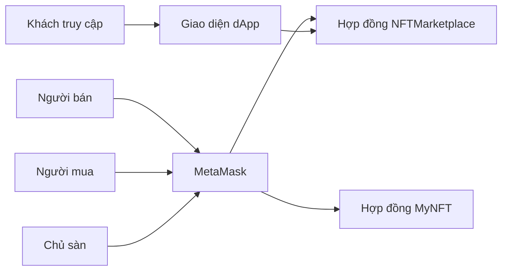
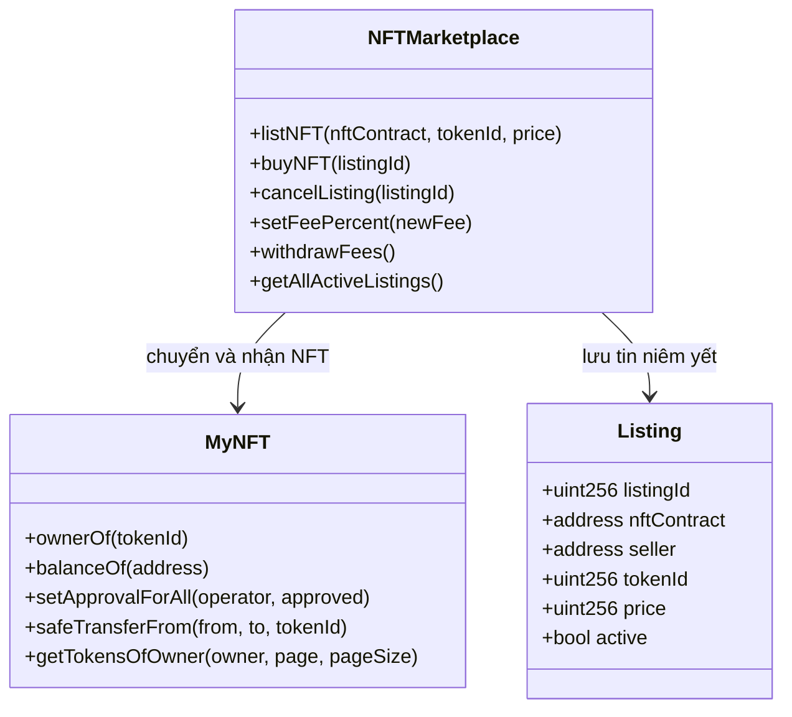
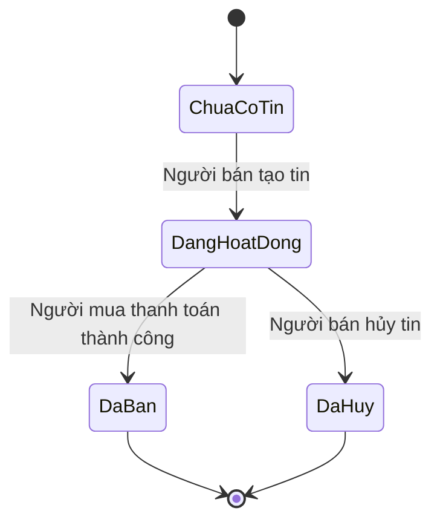
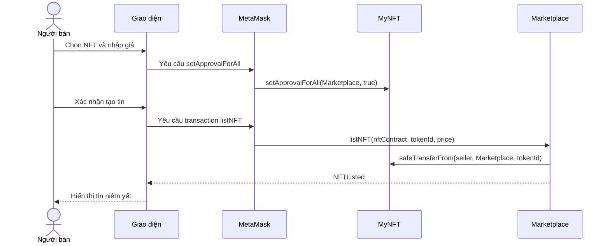
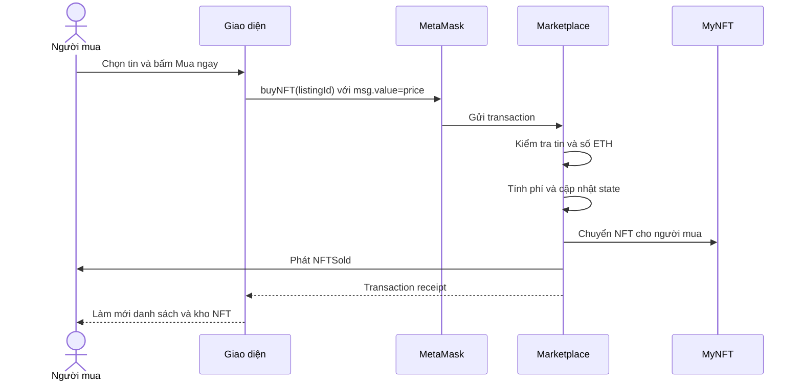
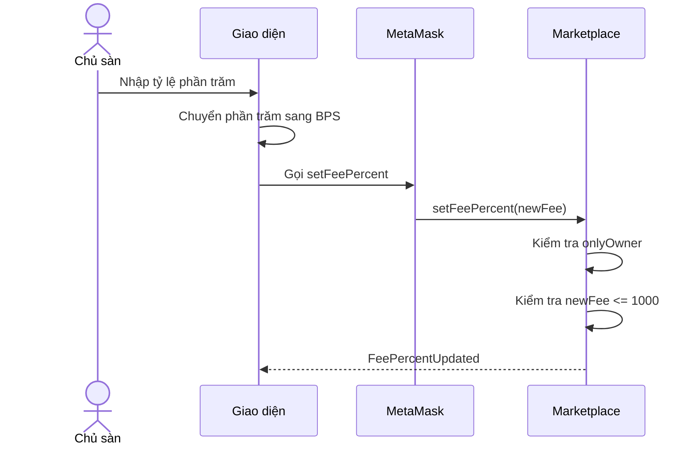
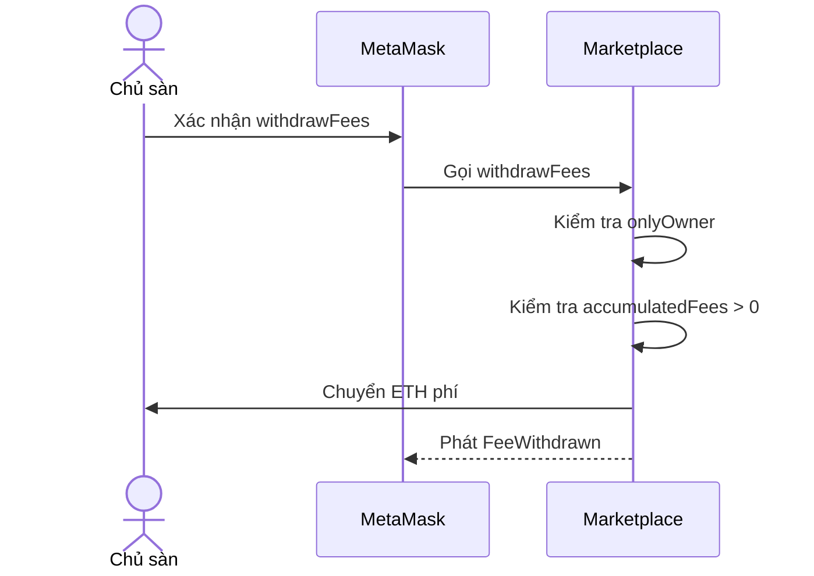

# CHƯƠNG 1. TỔNG QUAN ĐỀ TÀI

## 1.1. Bối cảnh công nghệ Blockchain, Web3 và khái niệm NFT

### 1.1.1. Blockchain và sổ cái phân tán

Blockchain là một cơ sở hạ tầng lưu trữ dữ liệu theo mô hình phân tán. Dữ liệu được nhóm thành các khối và liên kết theo thứ tự bằng hàm băm. Mỗi thay đổi đáng tin cậy phải tuân theo quy tắc xác thực và cơ chế đồng thuận của mạng. Trong một hệ thống blockchain, nhiều nút máy tính lưu trữ hoặc xác minh trạng thái chung, vì vậy dữ liệu không chỉ phụ thuộc vào một máy chủ trung tâm.

Mỗi giao dịch blockchain thường ghi nhận địa chỉ gửi, địa chỉ nhận, dữ liệu đầu vào, số tiền hoặc tài sản liên quan. Giao dịch được nút mạng xác thực, đưa vào khối và làm thay đổi trạng thái chung của mạng. Bản chất phân tán và có thể truy xuất dữ liệu giúp blockchain phù hợp với các bài toán cần ghi nhận quyền sở hữu, lịch sử giao dịch và tính minh bạch.

### 1.1.2. Smart contract và ứng dụng phi tập trung

Smart contract là chương trình được triển khai trên blockchain. Sau khi triển khai, hợp đồng thực thi đúng logic đã lập trình khi nhận giao dịch hợp lệ. Ethereum sử dụng Ethereum Virtual Machine (EVM) để thực thi bytecode của hợp đồng. Địa chỉ hợp đồng, dữ liệu đầu vào và trạng thái lưu trữ tạo thành các thành phần quan trọng trong quá trình thực thi.

Ứng dụng phi tập trung (dApp) kết hợp giao diện web, ví tiền điện tử và smart contract. Giao diện web chịu trách nhiệm hiển thị và thu thập thao tác. Ví điện tử lưu trữ hoặc quản lý tài khoản, trình bày giao dịch để người dùng xác nhận và tạo chữ ký. Smart contract lưu dữ liệu và thi hành các quy tắc nghiệp vụ trên blockchain. Trong mô hình này, người dùng có thể tương tác trực tiếp với blockchain thay vì gửi dữ liệu yêu cầu thay đổi tài sản cho máy chủ trung tâm.

Một smart contract cần được xem như thành phần xử lý nghiêm ngặt các quy tắc on-chain. Dữ liệu do frontend hiển thị có thể được chỉnh sửa hoặc giả mạo ở phía trình duyệt. Vì vậy, hợp đồng vẫn phải kiểm tra độc lập quyền sở hữu NFT, trạng thái tin niêm yết, số ETH thanh toán, địa chỉ người gọi và quyền quản trị.

### 1.1.3. Khái niệm NFT

NFT (Non-Fungible Token) là token không thể thay thế. Mỗi NFT trong một hợp đồng ERC-721 được đại diện bởi một `tokenId` duy nhất. Hai token ERC-721 không nhất thiết có giá trị hoặc thuộc tính giống nhau, ngay cả khi chúng thuộc cùng một hợp đồng.

NFT có thể đại diện cho:

- tác phẩm nghệ thuật số;
- vật phẩm trong trò chơi;
- vé hoặc giấy phép truy cập;
- tài sản trong thế giới ảo;
- tài liệu chứng thực;
- quyền lợi số được liên kết bằng dữ liệu ngoài chuỗi.

Việc sở hữu NFT trên blockchain là một bản ghi kỹ thuật do hợp đồng ERC-721 xác định. Bản ghi này không tự động xác lập quyền tác giả, quyền sở hữu hợp pháp hoặc bản quyền đối với tài sản ngoài đời thực. Trong đề tài, NFT được mô phỏng trên Hardhat Localnet và không có giá trị tài chính trên mạng công khai.

### 1.1.4. Sàn giao dịch NFT trong hệ sinh thái Web3

Sàn giao dịch NFT là ứng dụng giúp người sở hữu đăng tài sản, người mua tìm tài sản và hợp đồng thực hiện việc thanh toán cùng chuyển quyền sở hữu. Quy trình cơ bản gồm đăng bán, ký quỹ hoặc kiểm tra NFT, thanh toán, trích phí, chuyển NFT và ghi sự kiện.

Sàn giao dịch trong đề tài là một marketplace đơn giản, tập trung vào các nghiệp vụ:

- kết nối tài khoản MetaMask;
- xem kho NFT;
- cấp quyền cho hợp đồng marketplace;
- tạo tin niêm yết;
- mua tài sản đang niêm yết;
- hủy tin niêm yết;
- tính và tích lũy phí sàn;
- cho chủ sàn cập nhật tỷ lệ phí và rút phí.

Hệ thống không cung cấp đấu giá, thanh toán bằng nhiều loại token, quảng bá NFT, xác thực danh tính hoặc lưu trữ metadata nội dung lớn.

---

## 1.2. Lý do chọn đề tài, mục tiêu và phạm vi

### 1.2.1. Lý do chọn đề tài

Sàn giao dịch NFT là chủ đề phù hợp để nghiên cứu các khía cạnh của ứng dụng blockchain vì đề tài liên quan đồng thời đến quyền sở hữu tài sản, giao dịch đa tác nhân, ký quỹ, thanh toán ETH và phân quyền quản trị. Khi thực hiện đề tài, người học có thể quan sát các trạng thái NFT thay đổi sau từng transaction thay vì chỉ kiểm tra dữ liệu trong cơ sở dữ liệu truyền thống.

Các lý do cụ thể gồm:

- NFT thể hiện rõ đặc tính tài sản duy nhất trong blockchain.
- ERC-721 cung cấp tiêu chuẩn để lập trình và kiểm thử quyền sở hữu.
- Quy trình mua bán giúp làm rõ tính nguyên tử của giao dịch.
- Mô hình ký quỹ cho phép kiểm tra luồng chuyển NFT vào, ra khỏi hợp đồng.
- MetaMask giúp minh họa cơ chế ví điện tử và xác nhận giao dịch.
- Hardhat Localnet cho phép kiểm thử nhiều kịch bản mà không sử dụng tiền thật.
- Hệ thống đòi hỏi kết nối giữa smart contract, backend, frontend và ví.

Việc chạy mạng công khai có thể phát sinh phí gas và phụ thuộc vào mạng testnet hoặc mainnet. Đề tài chọn Hardhat Localnet để có thể khởi động lại node, reset dữ liệu, deploy lại hợp đồng và kiểm tra nhiều tình huống mà không phát sinh chi phí thực tế.

### 1.2.2. Mục tiêu của đề tài

#### Mục tiêu chung

Xây dựng một sàn giao dịch NFT mô phỏng trên blockchain cục bộ, cho phép người dùng đăng bán, mua, hủy tin niêm yết và quản lý phí giao dịch thông qua hợp đồng thông minh và giao diện web.

#### Mục tiêu cụ thể

1. Xây dựng hợp đồng `MyNFT` tương thích ERC-721 và mô phỏng kho NFT.
2. Xây dựng hợp đồng `NFTMarketplace` quản lý tin niêm yết và trao đổi NFT.
3. Tự động trích phí sàn theo BPS khi giao dịch mua thành công.
4. Giới hạn chức năng quản trị vào tài khoản owner.
5. Cho người bán cấp quyền cho marketplace và đăng bán NFT.
6. Cho người mua thanh toán ETH và nhận NFT.
7. Cho người bán hủy tin niêm yết còn hoạt động và nhận lại NFT.
8. Xây dựng giao diện React kết nối MetaMask và Hardhat Localnet.
9. Cung cấp API đọc dữ liệu blockchain bằng Express.
10. Viết unit test cho các quy tắc nghiệp vụ của hợp đồng.

### 1.2.3. Phạm vi nghiên cứu

**Phạm vi trong đề tài**

- Blockchain cục bộ: Hardhat Localnet.
- RPC: `http://127.0.0.1:8545`.
- Chain ID: `31337`.
- Đơn vị thanh toán: ETH giả lập.
- Sàn quản lý NFT ERC-721.
- Ba tài khoản demo: Chủ sàn, Alice và Bob.
- Ba dải NFT mô phỏng, mỗi dải gồm 10.000 token.
- Bốn nhóm thao tác giao diện: khám phá sàn, kho NFT, lịch sử và quản trị.
- Backend REST API ở vai trò đọc dữ liệu.
- Giao dịch ghi dữ liệu được MetaMask ký và gửi trực tiếp đến blockchain.

**Phạm vi ngoài đề tài**

- Thanh toán bằng tiền thật hoặc tài sản có giá trị thật.
- Đăng ký môi trường mainnet/testnet công khai.
- Lưu trữ metadata bằng IPFS hoặc hệ thống tương đương.
- Đấu giá và thanh toán bằng ERC-20.
- Xác thực người dùng bằng danh tính giấy tờ.
- Kiểm duyệt hoặc định danh NFT.
- Kiểm toán bảo mật chuyên nghiệp.
- Tối ưu hóa theo quy mô hàng triệu tin niêm yết.
- Xử lý reorg và webhook blockchain ở môi trường production.

### 1.2.4. Câu hỏi nghiên cứu

Đề tài giải quyết các câu hỏi sau:

1. Làm thế nào để lưu trữ và xác minh quyền sở hữu một NFT cụ thể?
2. Làm thế nào để kiểm tra người bán có quyền đăng bán NFT?
3. Làm thế nào để giữ NFT trong thời gian tin niêm yết còn hoạt động?
4. Làm thế nào để phân chia ETH giữa phí sàn và người bán?
5. Làm thế nào để ngăn người dùng mua chính tin niêm yết do mình tạo?
6. Làm thế nào để giới hạn việc thay đổi phí và rút phí?
7. Làm thế nào để hợp đồng tương tác an toàn với ví MetaMask?

---

## 1.3. Đối tượng sử dụng hệ thống

### 1.3.1. Chủ sàn

Chủ sàn là tài khoản triển khai hợp đồng marketplace và là owner của hợp đồng. Chủ sàn có quyền:

- xem tỷ lệ phí hiện tại;
- xem số ETH phí đã tích lũy;
- cập nhật tỷ lệ phí trong giới hạn hợp lệ;
- rút toàn bộ phí tích lũy;
- truy cập giao diện quản trị.

Quyền owner được kiểm tra bởi hợp đồng. Việc ẩn nút quản trị trên giao diện không thay thế cơ chế `onlyOwner`. Tỷ lệ phí mặc định là 250 BPS, tương đương 2,5%. Tỷ lệ tối đa được giới hạn ở 1.000 BPS, tương đương 10%.

### 1.3.2. Người bán

Người bán là tài khoản đang sở hữu NFT và muốn đăng tài sản. Quy trình sử dụng gồm:

1. kết nối ví MetaMask;
2. chuyển sang Hardhat Localnet;
3. xem danh sách NFT trong kho;
4. cấp quyền cho marketplace;
5. nhập Token ID và giá;
6. tạo tin niêm yết;
7. chờ giao dịch được xác nhận;
8. hủy tin niêm yết nếu cần.

Người bán chỉ được hủy tin niêm yết do chính mình tạo và tin đó còn hoạt động. Khi hủy thành công, NFT được chuyển khỏi marketplace trả về ví người bán.

### 1.3.3. Người mua

Người mua là tài khoản có ETH giả lập trong Hardhat Localnet và muốn mua NFT đang niêm yết:

1. kết nối ví;
2. xem danh sách tin đang hoạt động;
3. chọn NFT;
4. kiểm tra giá và người bán;
5. gửi transaction mua kèm số ETH bằng giá niêm yết;
6. xác nhận transaction trong MetaMask;
7. nhận NFT sau khi giao dịch thành công.

Người mua không thể mua chính tin niêm yết do mình tạo. Người mua gửi sai số ETH so với giá niêm yết sẽ làm giao dịch revert.

### 1.3.4. Ma trận phân quyền

| Tác nhân | Xem NFT | Tạo tin niêm yết | Mua NFT | Hủy tin niêm yết | Quản lý phí |
|---|:---:|:---:|:---:|:---:|:---:|
| Chủ sàn | Có | Có | Có | Chỉ tin của chính mình | Có |
| Người bán | Có | Có | Có | Chỉ tin của chính mình | Không |
| Người mua | Có | Không bắt buộc | Có | Không | Không |
| Khách truy cập | Có | Không | Không | Không | Không |

---

## 1.4. Cơ sở lý thuyết nền tảng

### 1.4.1. EVM và cơ chế thực thi

EVM thực thi bytecode của smart contract trong một trạng thái xác định. Giao dịch thay đổi state chỉ được ghi nhận khi node xác nhận transaction. Transaction gồm người gửi, địa chỉ hợp đồng, dữ liệu mã hóa, giá trị ETH và thông tin gas.

ABI (Application Binary Interface) mô tả cách mã hóa tên hàm, tham số và kiểu dữ liệu để ứng dụng JavaScript có thể gọi smart contract. ethers.js và Web3.js sử dụng ABI để tạo contract instance và mã hóa dữ liệu đầu vào.

### 1.4.2. Phí gas

Gas đo lượng tài nguyên tính toán cần thiết để thực thi một giao dịch. Trước khi gửi transaction, ví có thể hiển thị gas limit và gas price dự kiến. Trong Hardhat Localnet, ETH dùng để trả gas là ETH giả lập.

Phân biệt hai loại phí trong đề tài:

- **Phí gas:** khoản phí để blockchain thực thi và xác nhận giao dịch.
- **Phí marketplace:** tỷ lệ trích từ giá NFT khi giao dịch mua thành công.

Ví dụ, mức 250 BPS tương ứng 2,5%. Với giá 1 ETH, phí marketplace là 0,025 ETH và người bán nhận 0,975 ETH trước khi trừ phí gas của người bán.

### 1.4.3. Tiêu chuẩn ERC-721

ERC-721 là tiêu chuẩn mô tả NFT trên Ethereum. Các thành phần quan trọng gồm:

- `ownerOf(tokenId)`: trả về địa chỉ sở hữu NFT.
- `balanceOf(owner)`: trả về số NFT thuộc địa chỉ.
- `approve(to, tokenId)`: cấp quyền cho một địa chỉ đối với một NFT.
- `setApprovalForAll(operator, approved)`: cấp hoặc thu hồi quyền cho marketplace chuyển NFT.
- `safeTransferFrom(from, to, tokenId)`: chuyển NFT an toàn.
- `transferFrom(from, to, tokenId)`: chuyển NFT.
- `tokenURI(tokenId)`: cung cấp đường dẫn metadata khi hợp đồng triển khai.

Trong đề tài, người bán cấp quyền toàn bộ cho marketplace bằng `setApprovalForAll`. Sau đó, hợp đồng marketplace có thể chuyển NFT từ ví người bán vào hợp đồng và từ hợp đồng sang người mua.

### 1.4.4. Mô hình ký quỹ NFT

Ký quỹ là cơ chế hợp đồng giữ tài sản trong một thời gian để thực hiện giao dịch. Đề tài sử dụng ký quỹ có lưu giữ NFT:

1. Người bán cấp quyền cho marketplace.
2. Hợp đồng marketplace kiểm tra owner và giá.
3. Hợp đồng chuyển NFT từ người bán vào địa chỉ marketplace.
4. Tin niêm yết được lưu với trạng thái hoạt động.
5. Người mua gửi ETH bằng giá niêm yết.
6. Hợp đồng trích phí sàn.
7. Hợp đồng chuyển NFT cho người mua.
8. Hợp đồng chuyển phần còn lại cho người bán.

Cơ chế hủy tin niêm yết làm cho listing không còn hoạt động và hợp đồng chuyển NFT từ marketplace trở lại người bán.

### 1.4.5. Công thức tính phí

Giá niêm yết được lưu bằng wei. Hợp đồng tính phí bằng phép chia số nguyên:

```text
phí = giá × feePercent / 10.000
người bán nhận = giá − phí
```

Nếu `feePercent = 250`, hệ thống trích 2,5%. Với giá 1 ETH:

```text
phí = 1 × 250 / 10.000 = 0,025 ETH
người bán nhận = 1 − 0,025 = 0,975 ETH
```

Nếu giá quá nhỏ và phép chia làm tròn xuống bằng 0, người bán có thể nhận gần như toàn bộ giá. Luật tính phí phải được thống nhất trong unit test để tránh sai lệch kiểu dữ liệu.

### 1.4.6. Ownable

Ownable của OpenZeppelin xác định chủ sở hữu hợp đồng. Trong đề tài, các hàm quản trị có `onlyOwner`, gồm thay đổi mức phí và rút phí tích lũy.

Ownable không thay quyền sở hữu NFT. Một địa chỉ có thể là owner của marketplace nhưng không sở hữu toàn bộ NFT. Quyền quản trị phải được kiểm tra trong hợp đồng thay vì chỉ kiểm tra giao diện.

### 1.4.7. ReentrancyGuard

Reentrancy là tình trạng một hợp đồng bị gọi lại trong khi một hàm vẫn đang thực thi. Tấn công có thể khai thác luồng chuyển ETH để gọi lặp lại hàm rút tiền.

`ReentrancyGuard` của OpenZeppelin sử dụng trạng thái khóa trong suốt thời gian hàm đang chạy. Hàm được bảo vệ bằng `nonReentrant` sẽ từ chối lệnh gọi lồng vào. Hợp đồng áp dụng cơ chế này cho các thao tác mua NFT và rút phí. Tuy nhiên, ReentrancyGuard chỉ là một lớp bảo vệ, không thay thế kiểm tra điều kiện nghiệp vụ và unit test.

### 1.4.8. Tính nguyên tử

Giao dịch mua được thực thi theo cơ chế nguyên tử. Trong một transaction, hợp đồng có thể kiểm tra listing, tính phí, chuyển NFT và chuyển ETH. Nếu một bước revert, toàn bộ trạng thái của giao dịch được rollback. Tính chất này giúp tiền không bị chuyển nếu phần chuyển NFT thất bại hoặc listing không hợp lệ.

---

## 1.5. Công nghệ và công cụ sử dụng

### Bảng 1.1. Công nghệ và công cụ sử dụng

| Lớp | Công nghệ | Vai trò trong đề tài |
|---|---|---|
| Smart contract | Solidity `^0.8.24` | Viết hợp đồng ERC-721 và marketplace |
| Thư viện hợp đồng | OpenZeppelin Contracts `^5.6.1` | Cung cấp ERC721, Ownable, ReentrancyGuard |
| Blockchain cục bộ | Hardhat `^3.21.2` | Compile, deploy, local node và test |
| Kiểm thử | Mocha và Chai | Viết và chạy unit test hợp đồng |
| Giao tiếp blockchain | ethers.js `^6.17.0` | Gọi hợp đồng và ký giao dịch trong frontend |
| Thư viện Web3 | Web3.js `^4.16.0` | Hỗ trợ tương tác và kiểm thử RPC |
| Ví | MetaMask | Quản lý tài khoản, mạng và xác nhận giao dịch |
| Backend | Express + TypeScript `^5.3.0` | Cung cấp REST API chỉ đọc blockchain |
| Frontend | React `^19.3.1` | Xây dựng giao diện dApp |
| Styling | Tailwind CSS `^4.3.5` | Thiết kế giao diện |
| Build tool | Vite | Chạy máy chủ phát triển và build frontend |
| Biểu tượng | Lucide | Cung cấp icon trong giao diện |

Các phiên bản có ký hiệu `^` là phiên bản khai báo trong manifest. Phiên bản thực tế nên được đối chiếu từ lockfile hoặc lệnh kiểm tra dependency trước khi nộp báo cáo.

---

## 1.6. Yêu cầu chức năng và phi chức năng

### Bảng 1.2. Yêu cầu chức năng

| Mã | Yêu cầu | Tác nhân | Kết quả mong đợi |
|---|---|---|---|
| FR-01 | Kết nối MetaMask | Người dùng | Hiển thị địa chỉ tài khoản và mạng |
| FR-02 | Kiểm tra Chain ID | Người dùng | Yêu cầu chuyển hoặc thêm mạng 31337 |
| FR-03 | Xem kho NFT | Người dùng | Hiển thị NFT theo trang |
| FR-04 | Cấp quyền marketplace | Người bán | Hợp đồng được phép chuyển NFT |
| FR-05 | Tạo tin niêm yết | Người bán | NFT vào marketplace và tin trở thành active |
| FR-06 | Xem tin niêm yết | Người dùng | Hiển thị danh sách đang hoạt động |
| FR-07 | Tìm kiếm tin niêm yết | Người dùng | Lọc theo Token ID, người bán hoặc mã tin |
| FR-08 | Mua NFT | Người mua | Chuyển NFT và phân chia ETH |
| FR-09 | Hủy tin niêm yết | Người bán | Tin bị đóng và NFT được hoàn về người bán |
| FR-10 | Cập nhật phí | Chủ sàn | Lưu mức phí mới không vượt 1.000 BPS |
| FR-11 | Rút phí | Chủ sàn | Chuyển ETH phí tích lũy về ví owner |
| FR-12 | Xem lịch sử | Người dùng | Hiển thị event niêm yết, mua và hủy |

### Bảng 1.3. Yêu cầu phi chức năng

| Nhóm | Yêu cầu |
|---|---|
| Tính đúng đắn | Kiểm tra trạng thái NFT, tin niêm yết, giá và quyền owner |
| Tính an toàn | Giao dịch yêu cầu chữ ký; không lưu private key trong backend |
| Tính nguyên tử | Chuyển NFT và ETH chỉ hoàn tất trong cùng một transaction |
| Tính minh bạch | Nghiệp vụ quan trọng được ghi bằng event on-chain |
| Khả dụng học tập | Chạy local không cần ETH thật |
| Khả năng sử dụng | Hiển thị trạng thái loading và thông báo lỗi |
| Tính tương thích | Hỗ trợ mạng tương thích EVM có Chain ID 31337 |
| Giới hạn môi trường | Trạng thái Localnet có thể mất khi node reset |

---

## 1.7. Phương pháp thực hiện

Phương pháp thực hiện đề tài được tổ chức theo ba giai đoạn chính.

### 1.7.1. Giai đoạn khảo sát

- Phân tích bài toán và xác định ba vai trò chính.
- Nghiên cứu ERC-721, EVM, MetaMask và mô hình ký quỹ.
- Xác định các trạng thái tin niêm yết và quy tắc thanh toán.
- Xác định danh mục yêu cầu chức năng và phi chức năng.
- Chọn Hardhat Localnet làm môi trường triển khai và kiểm thử.

### 1.7.2. Giai đoạn thiết kế và triển khai

1. Thiết kế cấu trúc hợp đồng `MyNFT` và `NFTMarketplace`.
2. Thiết kế dữ liệu `Listing`, mapping và các event.
3. Thiết kế luồng cấp quyền và chuyển NFT.
4. Thiết kế luồng đăng bán, mua, hủy và rút phí.
5. Viết hợp đồng Solidity sử dụng OpenZeppelin.
6. Viết unit test bằng Hardhat, ethers, Mocha và Chai.
7. Viết REST API backend.
8. Xây dựng giao diện React gồm bốn tab.
9. Kết nối giao diện với MetaMask.
10. Viết script deploy và demo.

### 1.7.3. Giai đoạn kiểm thử và đánh giá

- Chạy compiler để phát hiện lỗi cú pháp và ABI.
- Chạy unit test hợp đồng cho luồng hợp lệ và không hợp lệ.
- Deploy hợp đồng trên Hardhat Localnet.
- Cấu hình MetaMask và thực hiện kịch bản người bán–người mua.
- Kiểm tra fee, quyền sở hữu, trạng thái tin và số dư tích lũy.
- Build frontend để phát hiện lỗi TypeScript và giao diện.
- Ghi nhận các giới hạn và hướng hoàn thiện.

Phương pháp đánh giá dựa trên kết quả kiểm thử và khả năng demo. Kết quả không được sử dụng để khẳng định độ bao phủ 100% hoặc bảo đảm an toàn sản xuất nếu chưa có audit độc lập.

# CHƯƠNG 2. PHÂN TÍCH, THIẾT KẾ HỆ THỐNG

## 2.1. Sơ đồ Use Case và phân quyền

### 2.1.1. Sơ đồ Use Case tổng quát

**Hình 2.1. Use Case tổng quát của hệ thống**



Ba tác nhân chính sử dụng hệ thống như sau:

- Người mua và người bán có thể xem tin niêm yết.
- Người bán cần cấp quyền và tạo tin niêm yết.
- Người bán có thể hủy tin do mình tạo.
- Người mua gửi ETH để mua tin đang hoạt động.
- Chủ sàn xem và rút phí, thay đổi mức phí.

### 2.1.2. Phân quyền

| Use Case | Chủ sàn | Người bán | Người mua | Khách |
|---|:---:|:---:|:---:|:---:|
| Kết nối ví | Có | Có | Có | Không |
| Xem NFT và tin niêm yết | Có | Có | Có | Có |
| Cấp quyền NFT | Có | Có | Có | Không |
| Tạo tin niêm yết | Có | Có | Có | Không |
| Hủy tin của mình | Có | Có | Không | Không |
| Mua NFT | Có | Có | Có | Không |
| Xem mức phí | Có | Có | Có | Có |
| Cập nhật/rút phí | Có | Không | Không | Không |

Chủ sàn được xác định bằng địa chỉ triển khai hợp đồng marketplace. Modifier `onlyOwner` ngăn tài khoản khác gọi các hàm quản trị dù giao diện có hiển thị hoặc thay đổi dữ liệu.

---

## 2.2. Kiến trúc tổng thể 3 tầng

### 2.2.1. Kiến trúc logic

**Hình 2.2. Kiến trúc ba tầng của hệ thống**

```text
+---------------------------------------------------------------+
| 1. TẦNG TRÌNH DIỄN                                            |
| React 19 + TypeScript + Tailwind CSS                          |
| Khám phá sàn | Kho NFT | Lịch sử | Quản trị                  |
+-------------------------------+-------------------------------+
                                |
                                | ethers.js / EIP-1193 / REST
                                v
+---------------------------------------------------------------+
| 2. TẦNG DỊCH VỤ                                               |
| MetaMask + Express REST API + Hardhat RPC                     |
| Ghi dữ liệu qua ví      |      Đọc dữ liệu qua API/provider    |
+-------------------------------+-------------------------------+
                                |
                                | RPC / EVM
                                v
+---------------------------------------------------------------+
| 3. TẦNG HỢP ĐỒNG THÔNG MINH                                   |
| MyNFT (ERC-721)        | NFTMarketplace (Listing và fee)      |
+---------------------------------------------------------------+
```

### 2.2.2. Luồng ghi dữ liệu

Luồng ghi dữ liệu không đi qua backend:

1. Người dùng thao tác trên giao diện.
2. Frontend gọi ethers.js để tạo contract call.
3. MetaMask trình bày transaction.
4. Người dùng xác nhận hoặc từ chối.
5. Transaction được gửi đến Hardhat RPC.
6. Hợp đồng kiểm tra điều kiện và thay đổi state.
7. Frontend nhận receipt và làm mới dữ liệu.

### 2.2.3. Luồng đọc dữ liệu

Backend cung cấp API REST chỉ đọc dữ liệu blockchain. Frontend gửi HTTP request đến backend, backend dùng ethers provider truy vấn node và trả JSON. Frontend cũng có fallback đọc trực tiếp qua MetaMask/provider nếu API không hoạt động.

Luồng này bảo đảm backend không giữ private key và không ký thay người dùng. Dữ liệu trả về vẫn phải được frontend đối chiếu với mạng và địa chỉ hợp đồng đang kết nối.

---

## 2.3. Thiết kế Smart Contract

### 2.3.1. Sơ đồ quan hệ hợp đồng

**Hình 2.3. Quan hệ hai hợp đồng**



### 2.3.2. Cấu trúc dữ liệu Listing

**Bảng 2.1. Thuộc tính của struct `Listing`**

| Thuộc tính | Kiểu dữ liệu | Ý nghĩa |
|---|---|---|
| `listingId` | `uint256` | Mã định danh duy nhất của tin niêm yết |
| `nftContract` | `address` | Hợp đồng ERC-721 chứa NFT |
| `seller` | `address` | Ví người tạo tin |
| `tokenId` | `uint256` | Mã NFT được niêm yết |
| `price` | `uint256` | Giá bằng wei |
| `active` | `bool` | Trạng thái hoạt động của tin |

### 2.3.3. Các hàm chính

#### Hàm `listNFT`

```solidity
listNFT(address nftContract, uint256 tokenId, uint256 price)
```

Chức năng:

1. kiểm tra địa chỉ NFT hợp lệ;
2. kiểm tra giá lớn hơn 0;
3. kiểm tra người gọi là owner của token;
4. tạo ID tin niêm yết;
5. lưu thông tin tin;
6. chuyển NFT vào hợp đồng marketplace;
7. phát sự kiện `NFTListed`.

Nếu người dùng chưa cấp quyền `setApprovalForAll`, hàm `safeTransferFrom` thất bại và toàn bộ transaction revert.

#### Hàm `buyNFT`

```solidity
buyNFT(uint256 listingId) payable
```

Chức năng:

1. kiểm tra tin đang hoạt động;
2. kiểm tra người mua khác người bán;
3. kiểm tra `msg.value == price`;
4. tính phí marketplace;
5. cập nhật trạng thái tin;
6. cập nhật phí tích lũy;
7. chuyển NFT cho người mua;
8. chuyển ETH cho người bán;
9. phát sự kiện `NFTSold`.

Hàm sử dụng `nonReentrant` để giảm rủi ro gọi lồng. Nếu một bước thất bại, transaction được rollback.

#### Hàm `cancelListing`

```solidity
cancelListing(uint256 listingId)
```

Chức năng:

1. kiểm tra tin đang hoạt động;
2. kiểm tra người gọi là seller;
3. đặt `active = false`;
4. chuyển NFT về người bán;
5. phát sự kiện `ListingCancelled`.

#### Hàm quản trị

`setFeePercent(uint256 newFee)` được bảo vệ bởi `onlyOwner` và giới hạn mức phí tối đa 1.000 BPS.

`withdrawFees()` được bảo vệ bởi `onlyOwner` và `nonReentrant`. Hàm rút toàn bộ ETH tích lũy của marketplace về ví owner.

### 2.3.4. Event

**Bảng 2.2. Các event nghiệp vụ**

| Event | Mục đích |
|---|---|
| `NFTListed` | Ghi nhận tin niêm yết được tạo |
| `NFTSold` | Ghi nhận giao dịch mua thành công |
| `ListingCancelled` | Ghi nhận tin bị hủy |
| `FeePercentUpdated` | Ghi nhận mức phí mới |
| `FeeWithdrawn` | Ghi nhận việc rút phí |

Event hỗ trợ frontend và backend truy xuất lịch sử. Giao diện hiện hỗ trợ một số event chính, chưa hiển thị đầy đủ mọi event quản trị.

### 2.3.5. Vòng đời tin niêm yết

**Hình 2.4. Vòng đời tin niêm yết**



- `active = true`: tin có thể được mua.
- `active = false`: tin đã bán hoặc đã hủy.
- Khi mua thành công, NFT ra khỏi escrow và chuyển cho người mua.
- Khi hủy, NFT ra khỏi escrow và chuyển về người bán.
- Không thể mua lại một tin đã đóng.

---

## 2.4. Chức năng của người dùng

### 2.4.1. Đăng bán NFT

**Hình 2.5. Sơ đồ tuần tự đăng bán**



Luồng hai transaction cần được người dùng xác nhận. Nếu người dùng hủy bước cấp quyền, bước niêm yết không thể chuyển NFT. Giao diện cần chờ receipt thay vì kết luận thành công ngay khi người dùng đã ký trong MetaMask.

### 2.4.2. Mua NFT

**Hình 2.6. Sơ đồ tuần tự mua NFT**



Ví dụ giá 1,5 ETH với phí 250 BPS:

- phí sàn: `1,5 × 250 / 10.000 = 0,0375 ETH`;
- người bán nhận: `1,5 − 0,0375 = 1,4625 ETH`;
- người mua nhận: NFT sau khi giao dịch thành công.

### 2.4.3. Hủy tin niêm yết

**Lưu đồ hủy tin**

```text
Bắt đầu
  |
  v
Kiểm tra tin có tồn tại?
  | Không -> revert
  v Có
Kiểm tra tin còn hoạt động?
  | Không -> revert
  v Có
Kiểm tra người gọi là seller?
  | Không -> revert
  v Có
Đặt active = false
  |
  v
Chuyển NFT về ví người bán
  |
  v
Phát ListingCancelled
  |
  v
Hoàn thành
```

### 2.4.4. Thứ tự kiểm tra trong các hàm

Các hàm thay đổi state được thiết kế theo nguyên tắc “kiểm tra trước, thay đổi sau, tương tác sau”. Chiến lược này giảm thiểu nguy cơ cập nhật trạng thái sai trong trường hợp chuyển NFT hoặc ETH thất bại.

---

## 2.5. Chức năng của chủ sàn

### 2.5.1. Xem phí

Chủ sàn truy cập tab **Quản trị sàn** để xem:

- địa chỉ owner;
- mức phí hiện tại;
- phí tích lũy có thể rút;
- trạng thái tài khoản MetaMask.

Dữ liệu được đọc bằng hàm `view` hoặc REST API. Giao diện chỉ hiển thị mục quản trị cho tài khoản owner, nhưng hợp đồng vẫn là nguồn kiểm tra quyền cuối cùng.

### 2.5.2. Thay đổi tỷ lệ phí

**Hình 2.7. Sơ đồ tuần tự cập nhật phí**



Ví dụ 5% tương ứng `500 BPS`. Tỷ lệ mới được áp dụng cho các giao dịch mua phát sinh sau khi transaction thay đổi phí thành công.

### 2.5.3. Rút phí

**Hình 2.8. Sơ đồ tuần tự rút phí**



Hàm rút phải kiểm tra chủ sở hữu và số dư tích lũy. Nếu chuyển ETH thất bại, transaction revert và không làm mất dữ liệu phí. Sau giao dịch thành công, phí tích lũy được đặt về 0.

---

## 2.6. Cơ chế đặc thù của hệ thống

### 2.6.1. Cấp 10.000 NFT cho mỗi tài khoản

Hợp đồng cung cấp ba dải Token ID:

| Tài khoản | Dải NFT |
|---|---|
| Chủ sàn | 1–10.000 |
| Alice | 10.001–20.000 |
| Bob | 20.001–30.000 |

Thay vì mint riêng lẻ từng NFT bằng 30.000 transaction, hợp đồng tăng số dư khởi tạo và xác định owner theo dải Token ID bằng logic nội bộ. Cách làm này phục vụ môi trường demo và giảm chi phí triển khai.

**Hình 2.9. Phân bổ kho NFT**

```text
Token 1 ────────── 10.000        Chủ sàn
Token 10.001 ───── 20.000        Alice
Token 20.001 ───── 30.000        Bob

Tổng: 30.000 NFT mô phỏng
Mỗi tài khoản: 10.000 NFT
```

Sau khi NFT được chuyển, owner của từng Token ID được cập nhật để truy vấn ERC-721. Đây là cơ chế mô phỏng; nó không tạo ra 30.000 sự kiện mint độc lập.

### 2.6.2. Phân trang kho NFT

Frontend gọi hàm `getTokensOfOwner(account, page, pageSize)` để lấy NFT theo từng trang thay vì tải toàn bộ danh mục. Giao diện có thể hiển thị 12 NFT mỗi trang trong luồng kho hiện tại.

Phân trang gồm:

- địa chỉ tài khoản;
- số trang;
- số NFT mỗi trang;
- tổng số NFT;
- danh sách Token ID thuộc trang.

### 2.6.3. Cách tính phí

**Hình 2.10. Phân chia thanh toán**

```text
Giá NFT
   |
   |---------- Marketplace Fee (feePercent)
   |---------- Người bán nhận (giá - phí)
   |
   +---------- Marketplace accumulatedFees
```

| Giá NFT | Tỷ lệ phí | Phí sàn | Người bán nhận |
|---:|---:|---:|---:|
| 1 ETH | 2,5% | 0,025 ETH | 0,975 ETH |
| 1,5 ETH | 2,5% | 0,0375 ETH | 1,4625 ETH |
| 2 ETH | 5% | 0,100 ETH | 1,900 ETH |

Phí được tính tại thời điểm mua bằng fee percent hiện hành. Cố định phí theo tin niêm yết không được thực hiện trong phiên bản hiện tại.

---

## 2.7. Thiết kế Backend REST API và giao diện

### 2.7.1. Trách nhiệm backend

Backend Express cung cấp API đọc dữ liệu blockchain. Backend không:

- lưu private key;
- ký transaction thay người dùng;
- xử lý thanh toán trực tiếp;
- thay đổi listing;
- thay thế smart contract;
- lưu dữ liệu giao dịch trong database ở phiên bản hiện tại.

Backend dùng ethers provider kết nối RPC để đọc contract state và event.

### Bảng 2.3. Các endpoint REST

| Endpoint | Phương thức | Mục đích |
|---|---|---|
| `/api/health` | GET | Kiểm tra backend và kết nối RPC |
| `/api/marketplace/info` | GET | Đọc owner, fee percent và accumulated fees |
| `/api/listings/active` | GET | Lấy tin niêm yết đang hoạt động |
| `/api/listings/history` | GET | Lấy lịch sử event được hỗ trợ |
| `/api/listings/:id` | GET | Tra cứu tin theo listing ID |
| `/api/nfts/:tokenId` | GET | Tra cứu thông tin NFT |

### 2.7.2. Thiết kế giao diện

Giao diện gồm bốn tab:

**Bảng 2.4. Cấu trúc giao diện**

| Tab | Chức năng chính |
|---|---|
| Khám phá sàn | Xem và tìm tin niêm yết, mua NFT |
| Kho NFT của tôi | Xem NFT, nhập giá và đăng bán |
| Lịch sử giao dịch | Xem event đã được frontend hỗ trợ |
| Quản trị sàn | Xem và cập nhật phí, rút phí |

Giao diện hiển thị trạng thái kết nối ví, Chain ID, địa chỉ tài khoản, số dư ETH, kết quả giao dịch và thông báo lỗi.

### 2.7.3. Dữ liệu đọc và ghi

| Loại thao tác | Thành phần thực hiện | Giao thức |
|---|---|---|
| Đọc listing | Backend hoặc frontend provider | REST hoặc RPC |
| Đọc NFT | Frontend, backend | RPC hoặc REST |
| Cấp quyền | Frontend + MetaMask | Transaction |
| Đăng bán | Frontend + MetaMask | Transaction |
| Mua NFT | Frontend + MetaMask | Transaction |
| Hủy tin | Frontend + MetaMask | Transaction |
| Quản lý phí | Frontend + MetaMask | Transaction |

---

## 2.8. Cấu trúc mã nguồn và quy trình triển khai

### 2.8.1. Cấu trúc thư mục

**Hình 2.11. Cấu trúc mã nguồn**

```text
NFT-Marketplace/
├── contracts/
│   ├── MyNFT.sol
│   └── NFTMarketplace.sol
├── test/
│   └── NFTMarketplace.ts
├── scripts/
│   ├── deploy.ts
│   ├── list.ts
│   ├── buy.ts
│   ├── cancel.ts
│   └── withdraw.ts
├── backend/
│   └── src/
│       ├── server.ts
│       ├── config/blockchain.ts
│       └── services/
├── frontend/
│   └── src/
│       ├── App.tsx
│       ├── services/marketplace.ts
│       └── contracts.json
├── hardhat.config.ts
└── package.json
```

### 2.8.2. Quy trình triển khai

**Hình 2.12. Luồng deploy**

```text
Hardhat config
      |
      v
Compile Solidity
      |
      v
Deploy MyNFT
      |
      v
Deploy NFTMarketplace
      |
      v
Ghi địa chỉ hợp đồng
      |
      +--> frontend/src/contracts.json
      |
      +--> backend/.env hoặc môi trường cấu hình
```

Khi deploy lại hợp đồng:

1. Khởi động Hardhat Localnet.
2. Compile hợp đồng.
3. Deploy `MyNFT`.
4. Deploy `NFTMarketplace`.
5. Ghi địa chỉ mới vào cấu hình frontend và backend.
6. Khởi động frontend.
7. Khởi động backend nếu cần.
8. Chuyển MetaMask sang Chain ID 31337.

### 2.8.3. Thách thức kỹ thuật

**Bảng 2.5. Thách thức và giải pháp**

| Thách thức | Nguyên nhân | Giải pháp |
|---|---|---|
| Địa chỉ hợp đồng thay đổi | Deploy lại local node tạo địa chỉ mới | Cập nhật file cấu hình sau deploy |
| Nonce MetaMask lệch | Localnet reset nhưng ví vẫn lưu nonce cũ | Xóa dữ liệu hoạt động của mạng local |
| Backend không khớp node | Backend và frontend dùng RPC/địa chỉ khác nhau | Kiểm tra `.env`, contracts.json và RPC |
| Không có backend | API chưa khởi động | Frontend có fallback đọc RPC |
| Trạng thái Localnet bị mất | Node restart/reset | Deploy lại hợp đồng |
| Event quá nhiều | Truy vấn log từ block 0 | Cân nhắc indexer hoặc cache |
| Dữ liệu NFT mô phỏng | Không mint từng token độc lập | Xác định owner theo dải Token ID |
| Giao diện hiển thị sai sai lệch | State frontend chưa đồng bộ receipt | Chờ receipt và làm mới dữ liệu |

### 2.8.4. Hướng hoàn thiện

Các hướng hoàn thiện sau khi kết thúc phiên bản demo gồm:

- thay cơ chế kiểm tra event bằng indexer;
- lưu metadata hoặc hình ảnh qua IPFS;
- lưu lịch sử trong cơ sở dữ liệu;
- thêm tìm kiếm và phân trang listing;
- tăng độ chính xác trong xử lý fee của giá nhỏ;
- thống nhất mức phí đầu vào;
- cấu hình CORS theo domain cụ thể;
- thêm test reentrancy và test quyền truy cập;
- thêm giới hạn độ dài và định dạng dữ liệu đầu vào;
- triển khai với kiểm toán khi đưa lên mạng công khai.
